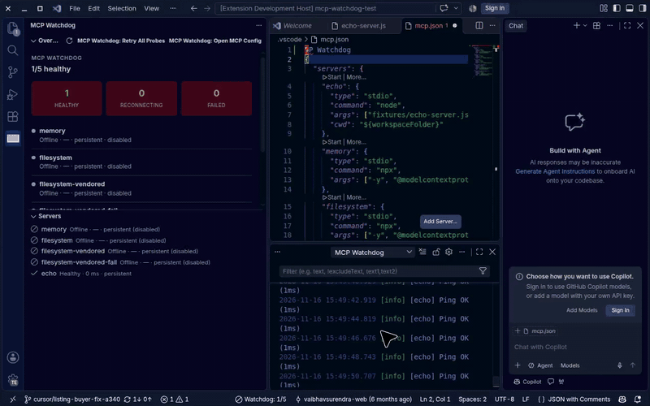
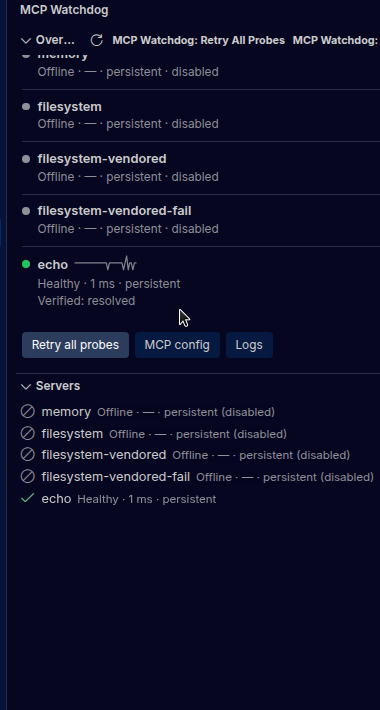
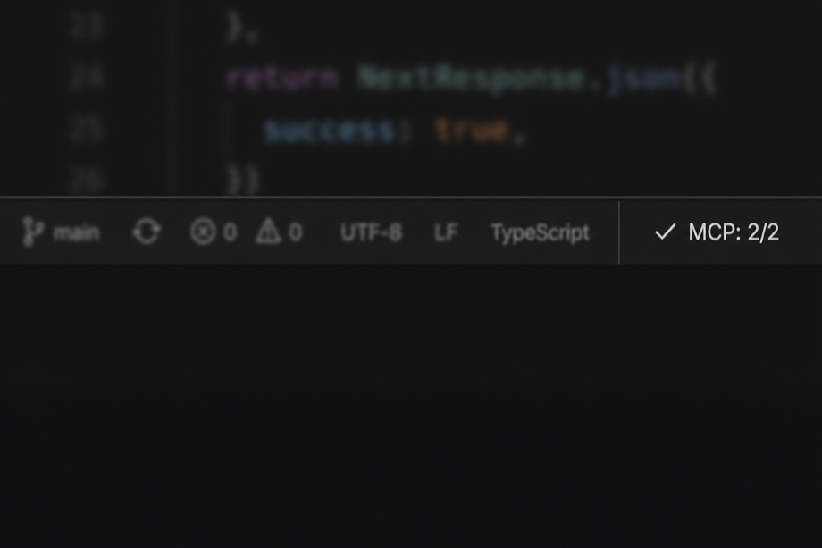
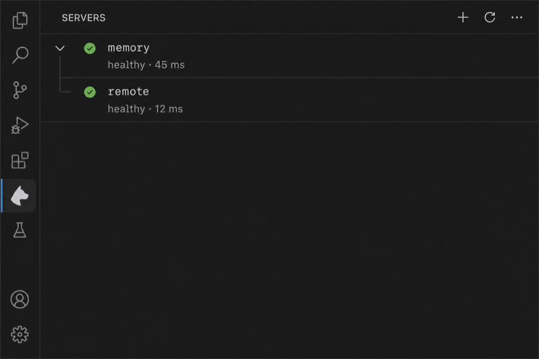

# MCP Watchdog

[](https://open-vsx.org/extension/mcp-watchdog/mcp-watchdog)
[](https://open-vsx.org/extension/mcp-watchdog/mcp-watchdog)
[](https://marketplace.visualstudio.com/items?itemName=mcp-watchdog.mcp-watchdog)
[](https://github.com/vaibhav11123/mcp-watchdog/actions/workflows/ci.yml)
[](https://github.com/vaibhav11123/mcp-watchdog/releases)
[](./LICENSE)

**Know which MCP servers are responding — independent of what the editor still shows.**

The editor can still show tools after a server has gone quiet — after idle, sleep, or a network drop. MCP Watchdog is an independent check of the servers you approved. It names the cause, offers a next step (Fix… / Show Log / Mute), and after a remediable Fix can show **Verified:** on Overview so you know recovery worked.

Not the same as Open VSX “MCP Doctor” config linters — Watchdog is a **live probe + dual-truth** status product (Watchdog green ≠ editor session).

Works in **Cursor**, **Windsurf**, **VS Code**, **VSCodium**, and other forks that install from [Open VSX](https://open-vsx.org/).

**Install (recommended for Cursor):** [MCP Watchdog on Open VSX](https://open-vsx.org/extension/mcp-watchdog/mcp-watchdog) — primary download channel for Cursor, Windsurf, VSCodium, and most VS Code forks.

**Repository:** [github.com/vaibhav11123/mcp-watchdog](https://github.com/vaibhav11123/mcp-watchdog)

## Quick start

1. Install from **[Open VSX](https://open-vsx.org/extension/mcp-watchdog/mcp-watchdog)** (Cursor / forks) or the [VS Marketplace](https://marketplace.visualstudio.com/items?itemName=mcp-watchdog.mcp-watchdog) (VS Code).
2. **Reload**, open a folder, then click the **activity bar MCP Watchdog** icon → **Overview** (not the Extensions detail page).
3. Approve servers when prompted. On failure: toast names the cause → **Fix…** → look for **Verified:** on the Overview row after recovery.

## Install channels

| Channel | Who | How |
|--------|-----|-----|
| **[Open VSX](https://open-vsx.org/extension/mcp-watchdog/mcp-watchdog)** (recommended) | **Cursor, Windsurf, VSCodium, Trae**, most VS Code forks | [Install on Open VSX](https://open-vsx.org/extension/mcp-watchdog/mcp-watchdog) or Extensions search `MCP Watchdog` |
| **[VS Marketplace](https://marketplace.visualstudio.com/items?itemName=mcp-watchdog.mcp-watchdog)** | VS Code (Microsoft build) | Extensions search → `mcp-watchdog.mcp-watchdog` |
| **[GitHub Releases](https://github.com/vaibhav11123/mcp-watchdog/releases)** | Airgapped / manual | Download the `.vsix` → **Install from VSIX…** |

CLI: `cursor --install-extension mcp-watchdog.mcp-watchdog`

## Editor

Watchdog opens its own connection to each approved server. The status bar shows **`Watchdog: healthy/total`**. Overview and the Servers tree show latency and a short failure snippet.

That result is Watchdog’s probe. It does not read the editor’s MCP client, so a green Watchdog row does not mean the editor’s own session is healthy.

When a check fails:

- **Failure toast (≤3):** **Fix…** / **Show Log** / **Mute 1h** — cause sentence in plain language.
- **Overview / commands:** **Accept**, **Remove**, **Retry probe**, **Reload Window**, and (in **Fix…** only when the host supports it) **Restart editor MCP**. Cursor often cannot restart host MCP — Watchdog will not fake that.

## Terminal companion (optional)

Unannounced CLI for Claude Code-style configs (same cause taxonomy; **host session stays Unknown**).

**Open VSX / Marketplace install does not add `mcp-watchdog` to your shell PATH.** Use a **repo clone** (supported workflow):

```bash
npm ci && npm run build
node bin/mcp-watchdog.mjs doctor
node bin/mcp-watchdog.mjs fix          # plan only
node bin/mcp-watchdog.mjs fix --yes    # backup + allowlisted apply + re-probe
node bin/mcp-watchdog.mjs restore --from .mcp-watchdog/backups/<file>
node bin/mcp-watchdog.mjs rate         # gh star when possible + one store listing
```

Command Palette: **MCP Watchdog: Star on GitHub + rate / review…** (disclosed star + in-IDE Marketplace on VS Code, or one Open VSX page on Cursor). Does **not** auto-post store reviews. Ask-after-recovery is one-shot — **Not now** never nags and never stars. CLI: `rate` opens the store; `rate --star` also stars via `gh`.

Never prints secret env values. Editor Overview remains the primary product surface.

## Demo



Independent probe → cause sentence → Fix… → **Verified:** on Overview when recovery works.

## Where is the UI?

| Place | What you see |
|--------|----------------|
| **Extensions** → click **MCP Watchdog** | Store **README** only — not the live dashboard. |
| **Activity bar** → **MCP Watchdog** icon | **Overview** + **Servers** — the real UI. |

Walkthrough: **Help → Welcome → MCP Watchdog: Get started**, or **MCP Watchdog: Open Servers View**.

## Requirements

- **VS Code** / **Cursor** (`engines.vscode`: `^1.105.0`) and a **workspace folder**.
- MCP config in at least one of: `.vscode/mcp.json`, `.cursor/mcp.json`, `~/.cursor/mcp.json`, VS Code user `mcp.json`, Windsurf `mcp_config.json`, Claude Code `~/.claude.json`, Claude Desktop `claude_desktop_config.json` (layers merge; workspace overrides globals).

## Watchdog Cloud (preview — optional)

Cloud is **not** required for the editor product. Start with status bar + failure toast + **Verified:** in the editor.

If you self-host later: remote health checks, schema change alerts, and configuration policy checks with an audit trail (policy runs outside the MCP tool-call path). Opt-in via `mcpWatchdog.cloudBridge.enabled` and `cloudBridge.url` (names-only incidents; fail-soft). Default is off. Self-host notes: [packages/cloud/README.md](./packages/cloud/README.md).

## Screenshots

**Overview after Fix** — quiet **Verified: resolved** on a healthy row (recommend punchline):



**Status bar** — aggregate health (`Watchdog: healthy / total`) on the bottom right (distinct from the editor’s own MCP chip):



**Servers** view — per-server state and last ping latency in the MCP Watchdog activity bar sidebar:


### Example `mcp.json`

```json
{
  "servers": {
    "memory": {
      "type": "stdio",
      "command": "npx",
      "args": ["-y", "@modelcontextprotocol/server-memory"]
    },
    "remote": {
      "type": "http",
      "url": "http://localhost:3000/mcp",
      "headers": { "Authorization": "Bearer YOUR_TOKEN" }
    }
  }
}
```

**Security:** only configure servers you trust. This extension runs **`command`** (e.g. `npx`, `node`) and opens **HTTP(S)** URLs you specify. It declares **`untrustedWorkspaces.supported: false`**, so it does **not** activate in VS Code **Restricted Mode**; open a trusted folder (and use Watchdog’s own approval gate) before monitoring.

Config strings expand **`${workspaceFolder}`**, **`${userHome}`**, and **`${env:NAME}`** (see below). A third transport is **SSE**: `type: "sse"` (or `url` plus `transport: "sse"`); prefer Streamable HTTP when the server supports it.

### Trust & consent

By default (**`mcpWatchdog.requireApproval`**: `true`), Watchdog **does not** spawn stdio processes or open HTTP connections until you approve. On first load (or after `mcp.json` changes), you get a notification with **Review & Allow** / **Not now**. **Review & Allow** opens a multi-select list of every server (`name — command args` or `name — url`); only the subset you confirm is monitored. Approval is stored per workspace folder and survives reloads. Changing a command, arg, or URL in config re-prompts. **Not now** leaves the status bar at `$(shield) Watchdog: untrusted` — click it to review again. Set **`requireApproval`** to `false` on a trusted single-user machine to auto-connect like 0.1.x.

### Config lint

With **`mcpWatchdog.diagnostics.enabled`** (default `true`), Watchdog reports `mcp.json` structure issues in the **Problems** panel: invalid JSON, a missing `servers` / `mcpServers` root, and entries that have neither `command` nor `url`.

### Variable expansion

In config strings (and nested arrays/objects), Watchdog expands:

- **`${workspaceFolder}`** — that layer’s workspace folder (first folder for global layers)
- **`${userHome}`** — the OS home directory
- **`${env:NAME}`** — environment variable; if unset, the literal `${env:NAME}` is left in place

**`${input:…}`** is not expanded (needs interactive UI). Env and header **values** are never logged or rendered in the UI.

### Failure context and auth

Failed or degraded servers show a short recent-log snippet on the **Servers** tooltip, **Overview**, and status-bar tooltip. HTTP **401** / Unauthorized surfaces as **`Auth required (HTTP 401)`** and stays in `failed` or `degraded` — Watchdog does not add a separate auth state or complete OAuth for you.

### Overview sparklines

The **Overview** webview draws a small latency sparkline from the last ~40 healthy ping samples per server, next to the server name.

### Incident timeline

Watchdog keeps an in-memory ring of the last ~200 state transitions (not written to disk until you export). Use **MCP Watchdog: Export Incident Timeline (Markdown)** to save that buffer as a Markdown file.

## Commands

- **MCP Watchdog: Show Server Status** — Quick pick with per-server state.
- **MCP Watchdog: Accept Failure** / **Unaccept Failure** — Drop or restore a failed server on the status-bar chip.
- **MCP Watchdog: Fix Failure…** — Guided remediation QuickPick.
- **MCP Watchdog: Remove Server** — Delete the key from the owning mcp.json (or Disable monitoring).
- **MCP Watchdog: Review Trusted Servers** — Change the approved subset or revoke trust.
- **MCP Watchdog: Retry All Probes** / **Retry Probe…**
- **MCP Watchdog: Open Servers View** — Focus the **Servers** tree.
- **MCP Watchdog: Open MCP Config** — Open or create `.cursor/mcp.json` / `.vscode/mcp.json`.
- **MCP Watchdog: Export Incident Timeline (Markdown)** — Save the in-memory incident ring (~200 transitions) as Markdown.

## Settings (`mcpWatchdog.*`)

| Setting | Default | Description |
|---------|---------|-------------|
| `pingIntervalMs` | `30000` | Ping cadence (ms). |
| `maxRetries` | `5` | Max reconnect attempts before marking failed. |
| `initialBackoffMs` | `1000` | First backoff after failure (ms). |
| `backoffMultiplier` | `1.5` | Backoff multiplier. |
| `maxBackoffMs` | `30000` | Backoff cap (ms). |
| `requireApproval` | `true` | Prompt before connecting to configured MCP servers. |
| `probeMode` | `interval` | `interval` = connect/ping/close each cycle; `persistent` = long-lived client (0.1.x behavior). |
| `perServer` | `{}` | Per-server `probeMode`, `pingIntervalMs`, `enabled` overrides. |
| `pingTimeoutMs` | `5000` | Ping/probe timeout (ms). |
| `notify` | `failures` | Toasts: `failures` (default), `all` (+ recovery), `none`. |
| `degradedAlertDelayMs` | `60000` | Wait before warning toast on sustained degraded state. |
| `diagnostics.enabled` | `true` | mcp.json structure lint in the Problems panel. |
| `checkEmptyTools` | `false` | After ping, `tools/list` → show tool count (advisory). |
| `detectToolDrift` | `false` | Fingerprint tool names; info toast when the set changes (advisory). |
| `passiveHttpProbe` | `false` | HTTP interval: HEAD/GET before MCP; reachable-but-MCP-fail → degraded advisory. |
| `reviewAfterRecoveries` | `3` | After N recoveries, ask **once** with a disclosed **Star on GitHub + open …** action. **Not now** forever suppresses (no star write). `0` = off interruptive ask. Does **not** auto-post Marketplace/Open VSX reviews. |
| `enableReviewAskPreview` | `false` | QA only: Preview review ask command. |
| `cloudBridge.enabled` | `false` | Opt-in: POST names-only incidents to self-hosted Watchdog Cloud. |
| `cloudBridge.url` | `""` | Cloud base URL (e.g. `http://127.0.0.1:8787`). |
| `telemetry.enabled` | `true` | Anonymous product usage via PostHog (allowlisted events). Also requires the editor’s telemetry setting. |
| `perServer.*.authProbe` | unset | Optional post-ping `tools/call` to verify credentials (may have side effects). |

### Opt-in advisories

These never force a server into `failed` on their own:

- **`checkEmptyTools`** — after a successful ping, call `tools/list` and show a tool count on Overview / tree.
- **`detectToolDrift`** — fingerprint sorted tool **names**; when the set changes, show an info toast via `toolDriftNote` (kept out of `lastError` so healthy servers do not look failed).
- **`passiveHttpProbe`** — for HTTP servers in interval mode, HEAD/GET the URL before a full MCP connect; if the endpoint answers but MCP fails, mark **degraded** with an advisory message.

### Alerts

The **failure toast** stays at **≤3 actions:** **Fix…**, **Show Log**, **Mute 1h**. Other actions (**Accept**, **Remove**, **Retry probe**, **Reload Window**, **Quit Cursor**, and **Restart editor MCP** when `workbench.mcp.*` exists) live on Overview / commands / the Fix Quick Pick — not piled onto the toast. Accept quiets the chip without marking the server healthy; Mute only silences toasts for 1h. Retry probe only restarts Watchdog’s check. Set `mcpWatchdog.notify` to `all` to also get recovery toasts. Repeated failures within 10 minutes collapse into a single **flapping** warning.

### Auth probe (opt-in)

Per-server `mcpWatchdog.perServer.<name>.authProbe` can call one MCP tool after a successful ping to verify credentials. **Default: unset (read-only).** May have side effects or cost — enable only when you understand the tool.

### Probe modes

| Mode | Behavior | When to use |
|------|----------|-------------|
| **interval** (default) | Each cycle connects, pings, then closes — no duplicate stdio process between checks. | Most servers; avoids leaving extra `npx` children running. |
| **persistent** | Keeps one MCP client open and pings on an interval. | Stateful servers that lose session state on disconnect (use deliberately). |

Settings changes apply within ~1s without reloading the window; **`mcp.json`** edits reload monitors via the file watcher.

## Privacy & data

- **Product telemetry (PostHog)** is **on by default** (`mcpWatchdog.telemetry.enabled`). Anonymous allowlisted events (activation, triage, commands) use a random install id — never env/header **values**, secrets, workspace paths, or raw error text. Setting is in Settings (search “telemetry”); also blocked when the **editor’s telemetry** setting is off. Dictionary: [`telemetry.json`](telemetry.json).
- Watchdog monitors servers from **merged mcp.json layers**. Cursor may list additional editor/plugin MCPs that are not in those files; the status-bar `N/M` is healthy/total of Watchdog’s set.
- Separate from telemetry: traffic to **your configured** MCP servers only (stdio / HTTP as in `mcp.json`).
- Opt-in **Cloud bridge** (`cloudBridge.enabled`, default off) posts **names-only** incidents to your self-hosted Cloud (fail-soft if unreachable).
- Do **not** commit secrets inside `mcp.json` in shared repos; use environment variables or secret stores appropriate to your team.

## Known limitations

- Reads workspace **`.vscode/mcp.json`** / **`.cursor/mcp.json`** from **all** multi-root folders (later folders override same server names), plus globals **`~/.cursor/mcp.json`**, VS Code user **`mcp.json`**, Windsurf **`mcp_config.json`**, Claude Code **`~/.claude.json`**, and Claude Desktop **`claude_desktop_config.json`**. Global `${workspaceFolder}` expands using the **first** folder only.
- **Independent of the editor’s MCP UI**: native MCP may show different state until the next Watchdog ping.
- **HTTP transport** may combine SDK-level reconnection with Watchdog-level retries. **SSE** is supported via SDK `SSEClientTransport` but is deprecated upstream — prefer Streamable HTTP when possible.
- **Malformed `mcp.json`**: invalid JSON shows an error notification; fix the file and save.
- Tool-drift fingerprints are **name-only** (no schema hash); passive HTTP is a light HEAD/GET, not a substitute for MCP health.

## Troubleshooting

| Symptom | What to check |
|---------|----------------|
| **Servers** view is empty | Open a **folder** (not just a file). Add **`.cursor/mcp.json`** (Cursor) or **`.vscode/mcp.json`** (VS Code). Use the **activity bar** MCP Watchdog icon, not the Extensions detail page. |
| No **MCP Watchdog** in Output / no status | Folder open? MCP config present? Try **Developer: Show Running Extensions** → **MCP Watchdog** activated. |
| **No servers** / **0/n** | `servers` key missing or empty; path is wrong root in multi-root. |
| **Connecting** forever | `npx`/network blocked; stdio command wrong; HTTP URL/firewall. |
| `Ping failed: Not connected` then retry | Expected after killing a server or a network blip; Watchdog retries its own probe within your backoff settings. |
| Problems on `mcp.json` | Confirm `mcpWatchdog.diagnostics.enabled` is on. Fix invalid JSON, a missing `servers`/`mcpServers` root, or an entry with neither `command` nor `url`. |
| **Auth required (HTTP 401)** | Token or header on that HTTP/SSE server is missing or expired. Watchdog does not complete OAuth. |
| Status bar **`Watchdog: untrusted`** | Run **MCP Watchdog: Review Trusted Servers** (or click the status bar) and approve the servers you want monitored. |

See **Screenshots** above for the Marketplace / README visuals.

## Maintainers

Build, F5, ship checklist, and private ops links: **[CONTRIBUTING.md](./CONTRIBUTING.md)**. Changelog: [CHANGELOG.md](./CHANGELOG.md). Cloud self-host: [packages/cloud/README.md](./packages/cloud/README.md).

## License

MIT — see [LICENSE](./LICENSE).

Security: see [SECURITY.md](./SECURITY.md).
