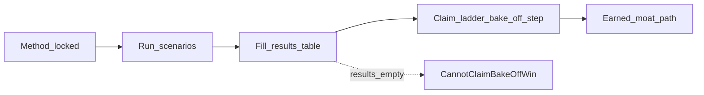

# MCP Watchdog — competitive bake-off (proof gate)

**Status:** Method locked (2026-11-07). Competitive + Phase 3 re-bake filled same day (all pins scored — no DNF). Eng **pass** on re-bake (35/36, Recover=2 on S1–S5); marketing announce still waits for **0.6.0**.  
**Progress overview:** [STATUS.md](./STATUS.md).  
**Product SoT:** [STRATEGY-THESIS.md](./STRATEGY-THESIS.md).  
**Architecture:** [TECHNICAL-ARCHITECTURE.md](./TECHNICAL-ARCHITECTURE.md).

This is the **first proof gate** before moat claims. Desk research ≠ bake-off.

---

## Goal

On the **same controlled failure scenarios**, score Watchdog vs named alternatives on:

1. **Diagnose** — did it identify the correct cause class (or honest Unknown)?
2. **Recover** — did a guided/automated path restore a healthy probe (verified)?
3. **Honesty** — did it avoid claiming host/editor health when unobserved?

North-star math: STRATEGY-THESIS “North-star metrics (v0 formulas)”.

Proof gate on the claim path — empty results block a bake-off win claim:

---

## Pinned competitors (exact artifacts)

Do not use ambiguous product names. Pin these for the first run:

| ID | Artifact | Lane | Wiring cost |
|----|----------|------|-------------|
| `watchdog` | This extension (Marketplace / Open VSX `mcp-watchdog.mcp-watchdog`) | IDE-native probe + Fix | Low (extension only) |
| `bastion-proxy` | [Gowthaman90/mcp-bastion](https://github.com/Gowthaman90/mcp-bastion) (npm MCP proxy) | Proxy / self-heal | Medium (config rewrite) |
| `pacemaker` | [girishkvs/mcp-pacemaker](https://github.com/girishkvs/mcp-pacemaker) | Long-lived bridge | Medium–high |
| `orbit` | [oaslananka/orbit-vsx](https://github.com/oaslananka/orbit-vsx) + companion `health-monitor-mcp` | IDE UI + **required companion** | High |
| `workbench-wb00` | Marketplace `wheelbarrel00.mcp-workbench-wb00` | Discover / validate / test connection | Low–medium |
| `mcpgawk` | Marketplace `gawk-dev.mcpgawk` (+ CLI) | Inventory / change / gateway | Medium |

**Out of first run (note only):** enterprise Bastion.tech governance, other “Workbench” YAML test runners, server-side author monitors (Merlonix/Spanly) — different job.

If an artifact cannot be installed in ≤30 minutes on the test machine, mark **DNF** for that scenario (do not invent scores).

---

## Scenarios (v0)

Each scenario: setup → induce failure → record product output → attempt recovery → re-check → score.

| ID | Failure | Expected Watchdog `causeId` (target) | Label notes |
|----|---------|--------------------------------------|-------------|
| S1 | Streamable HTTP server returns “No token provided” (no Authorization) | `auth.missing` | Same text for two server names → same class |
| S2 | HTTP 401 / Unauthorized | `auth.rejected` | |
| S3 | Session / credential expired language | `auth.expired` | AWS session = recipe overlay, not separate root class forever |
| S4 | stdio `command` missing (ENOENT) | `spawn.*` | |
| S5 | Probe fails after max retries; root text is auth-missing | Underlying auth class + `retryExhausted` | Never diagnose as “max retries” alone |
| S6 | Watchdog probe healthy; editor MCP session unknown/unavailable | Dual-truth: probe OK + host Unknown | Fail if product claims editor healthy |

Add S7+ only after v0 completes.

---

## Scoring rubric (per scenario × product)

| Dimension | 2 | 1 | 0 |
|-----------|---|---|---|
| Diagnose | Correct cause class or explicit Unknown with evidence | Vague but actionable | Wrong class / silent / misleading green |
| Recover | Verified restore (re-probe or equivalent healthy) | Partial / manual-heavy but documented | No path or false “fixed” |
| Honesty | Host Unknown when unobserved; no secret leakage in UI | Minor overclaim | Claims host healthy when unknown; shows secret values |

**Scenario score** = sum (0–6). **Product total** = sum over scenarios run. Report DNF separately.

**Pass for Watchdog “bake-off win” claim:** Watchdog total ≥ each pinned alternative that completed the same scenario set, **and** S1+S5+S6 not scored 0 on Diagnose or Honesty.

---

## Procedure

1. Clean profile / disposable mcp.json per product.
2. Run scenarios in order; capture screenshots or log excerpts (redact secrets).
3. Fill results table below.
4. Do **not** update STRATEGY claim ladder until this table has a dated run.

### Results (fill when run)

| Date | Host | Watchdog | bastion-proxy | pacemaker | orbit | workbench-wb00 | mcpgawk | Notes |
|------|------|----------|---------------|-----------|-------|----------------|---------|-------|
| 2026-11-07 | darwin-local-bakeoff | **35/36** | 23/36 | 19/36 | 19/36 | 19/36 | 23/36 | Phase 3 re-bake: Recover=2 on S1–S5 via `verifyRecovery`; S6 Recover=1. Pass rule met. [RUN-2026-11-07-phase3-rebake.md](./validation/bake-off/RUN-2026-11-07-phase3-rebake.md). |
| 2026-11-07 | darwin-local-bakeoff | **30/36** | 25/36 | 19/36 | 19/36 | 19/36 | 23/36 | First competitive (Recover≤1 all). [RUN-2026-11-07-competitive.md](./validation/bake-off/RUN-2026-11-07-competitive.md). Classifier-only: [RUN-2026-11-07.md](./validation/bake-off/RUN-2026-11-07.md). |

**Claim ladder:** Phase 3 re-bake **pass** (Watchdog ≥ all pins; S1/S5/S6 Diagnose+Honesty ≠ 0). Eng/docs may cite bake-off win with this date; **public marketing** still waits for maintainer **0.6.0** ([GTM-PUBLISH.md](./GTM-PUBLISH.md)).

---

## Relationship

Falsification if Bastion/Pacemaker win recurring problems **and** users accept wiring cost: STRATEGY-THESIS falsification tests + DESIGN.md overturn conditions.
