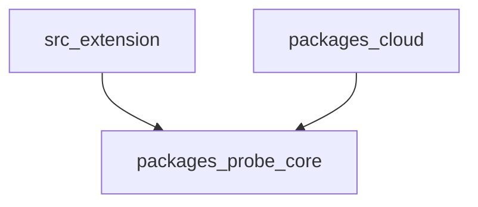
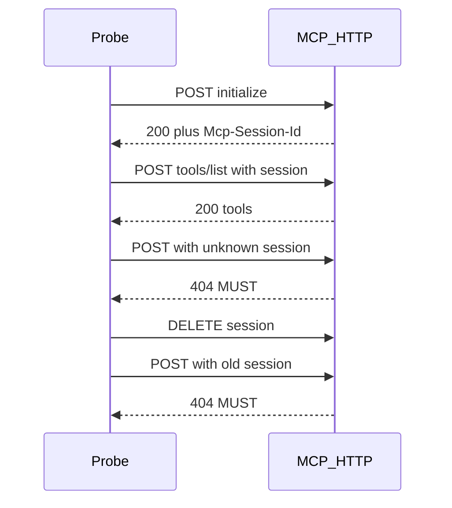

# MCP Watchdog — execution bible

Living execution doc for **historical Gates E0–E9** (IDE probe-core → Cloud preview → policy plane). Never call MVP a bare “MCP Gateway”.

> **Authority (2026-11-07):** Product identity → [STRATEGY-THESIS.md](./STRATEGY-THESIS.md). Near-term engineering (Phases 1–3 Doctor / adapters / verified recovery) → [TECHNICAL-ARCHITECTURE.md](./TECHNICAL-ARCHITECTURE.md). Bake-off → [BAKE-OFF.md](./BAKE-OFF.md).  
> [PRODUCT-DECISION.md](./PRODUCT-DECISION.md) is **historical raise narrative** (Cloud co-headline) — superseded for identity; do not prioritize Cloud/policy over Doctor for Phases 1–3.  
> Protocol default for shipped IDE probes: handshake-era **2025-11-25** until a modern-era spike closes (see ARCH §12). GTM/publish: [GTM-PUBLISH.md](./GTM-PUBLISH.md). Spikes: [spikes/](./spikes/).

**Phase numbering:** Thesis/ARCH “Phase 1–3” (Doctor → adapters → verify+KB) ≠ this file’s Gate 2–3 (Cloud / policy). Prefer thesis/ARCH names for new work.

---

## Sequence

| Step | Gate | Outcome |
|---|---|---|
| E0 | Docs | This file + GTM + gitignore + spike patches |
| E1 | — | HTTP pack fixtures + fixture server |
| E2 | — | `diffTools` + ≥20 goldens |
| E3 | — | Bridge scrub schema |
| E4 | **Gate −1** | T0–T2 benches green |
| E5 | **Gate 0** | `packages/probe-core`; compile + unit |
| E6 | **Gate 1** | IDE UX + visual QA |
| E7 | **Gate 2** | Cloud + bridge + T3 |
| E8 | **Gate 3** | Policy/trust plane |
| E9 | **Gate 4** | Adoption + paid-boundary memo |

---

## Logic locks

### HTTP probe packs (R1)

| Pack | Checks | Default alert? |
|---|---|---|
| **Liveness** | initialize OK; content-type json\|sse; tools/list shape; latency | Yes |
| **Session hygiene** | If session id: unknown → **404**; after DELETE (≠405) → **404** | Yes when sessionful |
| **Conformance** | Origin → 403; Accept; notif 202; protocol version 400; GET SSE\|405 | Opt-in only |

### Schema diff (R2) — covenant semantics

| Change | Severity |
|---|---|
| Tool removed; input required add / optional→required; input **required** remove | breaking |
| Tool added; input optional add / required→optional; input **optional** remove | info |
| Input type narrow / enum remove / enum constraint add / additionalProperties→false | breaking |
| Input type widen / enum add / enum drop | info |
| Output property/schema remove; type widen; enum add; enum drop; required→optional | breaking |
| Output property/schema add; type narrow; enum remove; optional→required | info |
| Description/title | patch |
| Reorder only | no diff |

### Bridge (R3)

Names-only allowlist. Reject `env` / `headers` / token keys. SecretStorage for tokens. Opt-in default off.

---

## Benchmarks

| ID | Gate |
|---|---|
| B-build | `npm run compile` exit 0 |
| B-unit | `npm run test:unit` exit 0; &lt; 30s |
| B-bundle | `npm run build` exit 0 |
| B-diff | 100% schema goldens |
| B-scrub | 0 secret payloads accepted |
| B-live-init | Fixture init+tools/list p95 &lt; 2000 ms (20 probes) |
| B-false-green | Kill fixture → next probe not healthy |
| B-session | Unknown session → 404 |
| B-origin-pack | Origin-only fail must not fail overall T0 |
| B-T3 | Self-host &lt; 30 min |
| B-dual | Bridge dual-truth visible within 5s |

---

## Package boundary

`packages/probe-core` is vscode-free. Extension and cloud both import it.

---

## HTTP session sequence (liveness + hygiene)

---

## Dual signal (tool names vs schema)

- **Name fingerprint** — fast IDE toast (`toolDrift`).
- **Schema hash + `diffTools`** — contract severity (`schemaDrift` / breaking vs info).

---

## Hard stops

- Never log/render env or header **values**
- States: `connecting|healthy|degraded|failed|disconnected` only
- Phase 3 = **policy/trust plane**, not proxy gateway
- MIT + CLA; paid = hosted later
