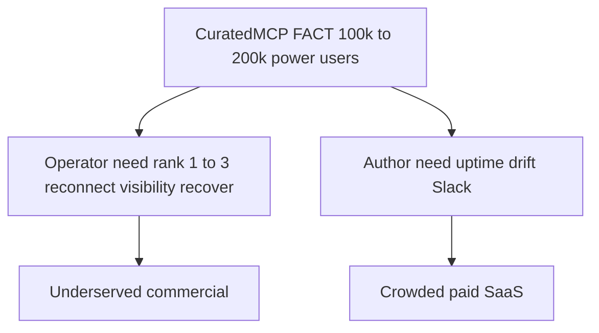

# Market research brief (primary sources only)

**Scope:** What people need, who pays, who competes. Not a Watchdog roadmap.

**How to read this:** Every number and name has a source. “FACT” = copied from a named report/vendor. “LORE” = verbatim user/staff themes from forums/issues. “RANK” = ordered by how often / how strongly those themes appear in this scrape—not invented strategy.

**As of:** 2026-10-30 (internet scrape). Do not treat directory totals as live healthy server counts.

---

## 1. Market size — FACT from CuratedMCP

Source: [CuratedMCP — The State of MCP in 2026](https://www.curatedmcp.com/learn/state-of-mcp-2026) (May 5, 2026). This is the report labeled FACT-from-report in the Problem 3 brief.

| Claim (as stated by CuratedMCP) | Number |
|---|---|
| Cursor DAU | 1M+ |
| Cursor paying customers | 360k |
| Claude Desktop mobile MAU | 12.48M |
| Claude Desktop web MAU | 18.9M |
| Devs using ≥1 MCP in production (conservative) | ~500k–1M |
| Power users (3+ servers daily) — “segment paying for tooling” | **~100k–200k** |
| Public directory scale (mid-2026 in that piece) | 10k+ servers (+~10k forks/abandoned) |
| Paid MCP / related tooling price band (individuals) | **$19–29/mo** Pro; teams $99–499 |

Later ecosystem counts differ by registry (Oct 2026): [MCP Toplist ecosystem report](https://mcptoplist.com/reports/mcp-ecosystem/2026-10) reports ~139k–163k active listings across Glama/Official/PulseMCP/mcp.so/Smithery after dedupe; handshake success on probed remotes is low (~27% in that report). Treat “10k” vs “100k+” as **registry inflation**, not active healthy servers.

[SettleGrid monetization report](https://settlegrid.ai/learn/state-of-mcp-2026) (Mar 2026): <5% of servers monetized; agent-to-tool payment volume <$50k/day — supply without revenue for most authors.

Clutch Security trenches PDF (2025): in a 10k-employee model, ~15% of employees run local MCP; 86% local vs 14% remote; 38% unofficial implementations — enterprise “shadow MCP” is real.

---

## 2. Need rank — LORE from operators (Cursor / Claude)

Ranked by recurrence in this internet scrape (forum feature requests + bugs + Claude Code issues). This is **operator** demand (people using agents), not server-author demand.

| Rank | Need (job) | Evidence (names + lore) |
|---|---|---|
| 1 | **Auto-reconnect / resilience** without manual toggle | [forum/135368](https://forum.cursor.com/t/mcp-auto-reconnect-after-server-disconnection/135368) (“toggle twice… users not aware”); [forum/150510](https://forum.cursor.com/t/better-resilience-for-mcp-services/150510); staff @deanrie: known, workaround = toggle or reload; [claude#15232](https://github.com/anthropics/claude-code/issues/15232) “all I'm doing is a cmd+r… can't you do that somehow yourself?”; [claude#43177](https://github.com/anthropics/claude-code/issues/43177) stdio excluded from reconnect |
| 2 | **Visible failure** outside Settings | [forum/146780](https://forum.cursor.com/t/improve-mcp-connection-persistence-visibility/146780): “status only visible inside MCP Settings”; want banner / Problems; reply on 150510: “better way to visualise that MCP is disconnected outside of settings” |
| 3 | **Recover without full quit** | [forum/149353](https://forum.cursor.com/t/mcp-servers-disconnect-repeatedly-not-connected-error/149353) + [cursor#3994](https://github.com/cursor/cursor/issues/3994): both MCPs `Not connected`; “Only full restart fixes”; staff: SSE known issue, try toggle |
| 4 | **Survive sleep / network / redeploy** | [forum/151578](https://forum.cursor.com/t/cursor-mcp-client-fails-to-reconnect-after-network-drop-or-sleep-wake-cycle/151578); [forum/143016](https://forum.cursor.com/t/when-the-mcp-server-restarts-the-mcp-in-the-cursor-does-not-work-when-using-the-streamablehttp-type/143016) Invalid session ID after server restart |
| 5 | **Honest status (UI ≠ reality)** | [pieces-app/support#796](https://github.com/pieces-app/support/issues/796): red but tools work; [forum/149434](https://forum.cursor.com/t/ui-shows-wrong-mcp-server-status/149434); Context7 [upstash#686](https://github.com/upstash/context7/issues/686) |
| 6 | **Lease / timer flakes** | [forum/159736](https://forum.cursor.com/t/cursor-ide-browser-mcp-disconnects-every-5-minutes-during-heavy-agent-browser-usage/159736): ~5 min `status=error`; staff @mohitjain known |
| 7 | **Trust / quality before connect** | CuratedMCP quality-crisis narrative; [OWASP MCP cheat sheet](https://cheatsheetseries.owasp.org/cheatsheets/MCP_Security_Cheat_Sheet.html); Server Card playbooks — **rising**, but quieter than daily reconnect rage in this scrape |

Staff lore (repeated): “known issue,” “no ETA,” workaround = toggle off/on or Reload Window / full restart. That keeps operator need open.

---

## 3. Competitor map — NAMES + prices (author-side vs operator-side)

### A. Who sells to **MCP server authors** (crowded, paid)

| Name | What they sell | Price (vendor page) |
|---|---|---|
| [Merlonix](https://merlonix.com/for/mcp-server-developers/) | Handshake + tools/list monitor, drift, Slack | Free + **$19 / $79 / $199 / $699**/mo |
| [Spanly](https://spanly.com/pricing/) | Observability, health monitors, security | Free + **~$83 / ~$416**/mo (+ packet overage) |
| [MCP Vitals](https://mcpvitals.com/) | External initialize→tools/list, badge, alerts | Free (1 server) + paid tiers ($15/$49 cited on compare page) |
| [AliveMCP](https://alivemcp.com/) | Registry crawl + 60s ping; claim listing | Free browse + **$9**/mo Author |
| [MCPatrol](https://mcpatrol.com/) | Cloud prober + inventory change alerts | (marketing; claim listing) |
| [AgentStatus](https://agentstatus.dev/) | Multi-host validation (Claude/Cursor/Codex…) | Host-compatibility monitoring |
| [MCP Pulse](https://mcp-pulse.com/) | Wrap stdio server, reliability score | CLI-first |

**Shared lore on these sites:** “HTTP 200 is not MCP alive”; schema drift; alert before agents choke. Buyer = person who **operates a remote MCP**, not the Cursor user whose UI went red.

**Cautionary name:** [MCP Doctor](https://mcpdoctor.ai/) — founder paused SaaS after demand validation failed; CLI remains free.

### B. Who sells **curation / governance / gateway** (CuratedMCP market map)

From CuratedMCP’s own five-category split:

1. Volume: Smithery, MCPMarket
2. Discovery: Glama, PulseMCP
3. Managed gateways: Composio ($29–$229), Klavis ($99–$499), Pipedream
4. Enterprise governance: Salesforce Agentforce, Kiteworks
5. Quality curation: CuratedMCP (self-claimed unique)

CuratedMCP product names/prices (platform overview PDF): Auditor free/$9 Pro; Sentinel $19.99/mo; Private Counsel $29/mo; Sovereign Suite $49/mo.

### C. Operator / in-IDE recovery (underserved)

| Name | Notes |
|---|---|
| **MCP Watchdog** | Open VSX / Marketplace extension; parallel probes + toasts + Reconnect/Reload; ~1.3k downloads (maintainer figure) |
| Cursor / Claude native | Users beg them to fix reconnect; staff workarounds only |

No Merlonix-class SaaS was found that sells “fix my Cursor MCP client when it lies.” That gap is structural: author monitors cannot see the IDE client state.

---

## 4. Two-buyer model (research conclusion)

| Buyer | Need rank leaders | Who gets paid today |
|---|---|---|
| Operator (Cursor/Claude power user) | Reconnect, visible alert, no full quit | Almost nobody commercial; extensions/free; IDE vendors |
| Author (ships remote MCP) | Handshake health, drift, pages | Merlonix, Spanly, AliveMCP, … $9–$699 |

CuratedMCP’s line that the 100k–200k power-user tier is “the segment paying for tooling” is **their** claim. Empirically in this scrape, **visible paid products** mostly bill **authors and enterprises**, while **loud unmet asks** are **operator reconnect/visibility**. Do not conflate those.

---

## 5. What this research does *not* prove

- That operators will pay $19–29/mo for an IDE recovery tool (price band is FACT for the market; WTP for *this* job is unproven).
- That Watchdog should pivot to author monitoring (that market is already named and priced).
- That Reddit reflects MCP pain (Problem 3 under-sample matches: pain is Cursor forum / GH / Claude issues).

---

## 6. Stop here until you choose a research deepening

1. Quote bank: 20 verbatim “I need X” lines from Cursor MCP threads (operator only)
2. Competitor teardown spreadsheet: Merlonix / Spanly / AliveMCP / MCP Vitals / MCPatrol only
3. CuratedMCP claim audit: which of their adoption numbers appear elsewhere
4. Operator WTP probes: any paid “Cursor MCP fix” products or sponsorships

No code. No repositioning. No funding deck.

---

## Source index

| Source | Role |
|---|---|
| https://www.curatedmcp.com/learn/state-of-mcp-2026 | FACT market size / power users / price band |
| https://settlegrid.ai/learn/state-of-mcp-2026 | Monetization &lt;5% |
| https://mcptoplist.com/reports/mcp-ecosystem/2026-10 | Registry inflation / handshake sample |
| Cursor forum threads listed in §2 | Operator LORE |
| Vendor URLs in §3 | Competitor NAMES + prices |
