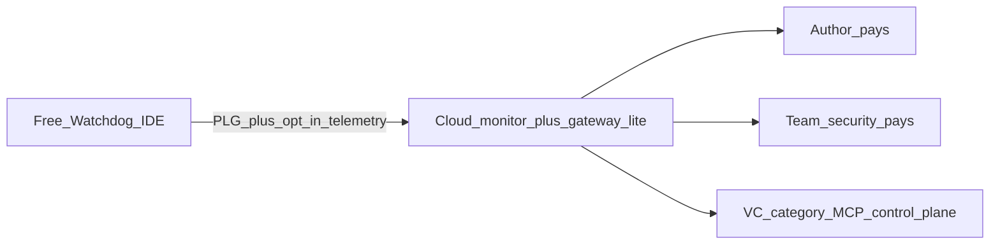

# Product decision — raise-oriented expand (desk research)

**As of:** 2026-10-30 (revised)  
**Constraint:** No founder interviews. Goal includes a path that can **raise**.  
**Why revise:** Operator IDE recovery is a real job but **commercially empty** vs author monitors and enterprise gateways (where checks and SKUs already exist). A toast-only company is not venture-scale. We **expand**, we do not abandon the IDE wedge.

**Public listing (2026-10-31):** category is **MCP reliability and diagnostics**. The marketplace lead is editor health checks (“Know which MCP servers are responding”). Cloud is the same product, marked **preview**, until the extension posts incidents. Public copy says **configuration policy checks**, not “trust plane.” Retry probe and Restart editor MCP are separate actions. Do not claim the extension reads the editor MCP client or already correlates probes.

---

## Decision (locked for fundraising narrative)

| Question | Answer |
|---|---|
| **Company / category thesis** | **MCP reliability + trust control plane** — from the developer edge to the servers agents depend on. |
| **Wedge (free, PLG)** | Keep **MCP Watchdog** IDE extension: status, alerts, recover CTAs, trust gate. Distribution into Cursor pain. |
| **Commercial product (what VCs underwrite)** | **Watchdog Cloud** (OSS; paid = hosted later): (1) **author / server monitor** (handshake, tools/list drift, alerts) + (2) **team policy/trust plane** (allowlist, approve/deny, audit — not an Obot-style proxy). |
| **Licensing** | **MIT** everywhere (IDE + cloud + probe-core) + **CLA**. Charge later for **hosted convenience / ops / support**, not closed-source core. |
| **Bridge** | **Opt-in from cloud MVP day one** — names-only incidents; never env/header values. |
| **Who pays** | MCP **authors** (uptime/drift) and **eng/security leads** (policy/audit) — same budget class as Merlonix/Spanly/Obot-adjacent, differentiated by **client-side truth** from the extension. |
| **What we are not (yet)** | Not a full Obot/Runlayer replacement on day one. Not dropping the extension. Not claiming Cursor auto-heal. |
| **Raise story** | Open-core: free IDE installs → cloud reliability + policy. Pitch the **category VCs already fund** (MCP infra / security / observability), with a unique entry (IDE health). |

---

## Why “empty commercially” forces this (not a contradiction)

| Lane | Pain | Paid / funded today? | Role in our company |
|---|---|---|---|
| Operator IDE | Loud | Almost no SKU | **Top-of-funnel + client truth** (free) |
| Author monitor | “HTTP 200 ≠ MCP alive” | Yes — Merlonix, Spanly, MCPVault Monitor, … | **Revenue surface #1** to add |
| Gateway / governance | Shadow MCP, IT control | Yes — Obot $35M, Runlayer $11M, Mintive, … | **Revenue surface #2** (gateway-lite, not full clone) |

FACT: capital and list prices sit in author + gateway lanes. DERIVED: staying IDE-only forever = bootstrap hobby; **adding** those surfaces is required to raise.

Industry pattern (devtools OSS→cloud): free adoption is funnel; paid cloud must be something OSS alone doesn’t give (hosted handshake fleet, Slack/PagerDuty, org policy, audit) — see open-core / hosted playbooks (Konvoy, Beacon-style “don’t compete with your own free product”).

---

## Differentiation (so we don’t die as Merlonix #8)

1. **Client + server loop:** IDE Watchdog sees what the *developer* experiences; cloud sees what the *server* advertises. One incident story: “Cursor showed tools; handshake was dead” / “UI red; handshake green.”
2. **Gateway-lite from trust.ts DNA:** allowlists, block unpinned `npx -y`, require HTTPS, approval audit — starts as policy for teams using Watchdog, not a 50-connector IdP suite on day one.
3. **Honest scope:** Full enterprise MCP gateway (Okta, SIEM, threat ML) is a later chapter or partnership; seed MVP is **monitor + policy + audit**.

---

## What to build (sequence for a raise)

### Now — free IDE (keep shipping)

Status bar, toasts, Reload/Reconnect/Quit clarity, dual-truth, trust UI. Grow Open VSX. This is the PLG wedge investors need as adoption proof.

### Next — cloud MVP (fundable surface)

| Module | Buyer | MVP |
|---|---|---|
| **Author monitor** | Ships remote MCP | Scheduled initialize + tools/list; Slack/email on down/drift; public or private status |
| **Policy / trust plane (Teams)** | Eng manager / security | Org allowlist of MCP commands/URLs; approval log; optional force Watchdog install policy — **not** a reverse-proxy gateway |
| **Bridge** | Both | Link workspace Watchdog incidents ↔ monitored server IDs (opt-in) |

Pricing anchors (market FACT, not commitment): author tools ~$9–$79+/mo; individuals $19–29; teams higher; gateways often sales-led.

### Later — deepen gateway

IdP, SIEM export, catalog — only after monitor+policy revenue or design partners; do not boil the ocean vs Obot on day one.

---

## Raise readiness (desk)

| Have today | Need for pre-seed/seed |
|---|---|
| IDE product + ~1.3k downloads | Usage slope; cloud MVP; 3–5 design partners or paid pilots on **monitor or Teams** |
| Problem lore | Logos using cloud in production |
| Category adjacent to funded comps | Clear free vs paid line in deck |

**Pitch line:** “Every agent stack needs MCP reliability. We start where failure is felt (the IDE), then sell the control plane authors and teams already pay for — monitor + policy — with client-side ground truth others lack.”

---

## Explicit supersede

This **replaces** the earlier “operator-only / no author SaaS / no raise” lock. Operator free core remains; **author monitor + gateway-lite are in scope** because commercially empty IDE lane cannot carry a venture raise alone.
