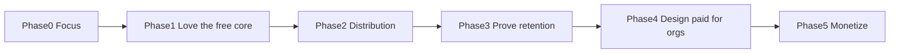
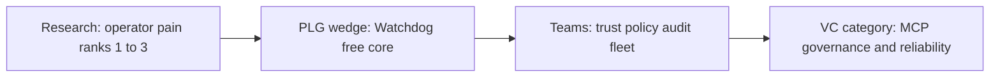

# MCP Watchdog — product strategy (industry-grade)

> **Authority (2026-11-07):** [STRATEGY-THESIS.md](./STRATEGY-THESIS.md) + [TECHNICAL-ARCHITECTURE.md](./TECHNICAL-ARCHITECTURE.md). Prefer those over this file when they conflict.  
> **Phase numbering:** This file’s **PLG Phase 1–5** are monetization/PLG phases — not thesis Doctor Phases 1–3.  
> [PRODUCT-DECISION.md](./PRODUCT-DECISION.md) = historical raise expand only.

**Status:** Historical PLG / monetization strategy notes. Not a build sprint. Monetization remains **deferred**.  
**Inputs:** [MARKET-RESEARCH.md](./MARKET-RESEARCH.md), codebase audit (v0.5.2 era), Open VSX / Marketplace stats (2026-10-30).  
**Current product rule:** IDE reliability + recovery intelligence first; Cloud/author monitor later per STRATEGY-THESIS.  
**Where to ship:** host coverage ladder in STRATEGY-THESIS (Cursor/Open VSX → Claude Code–class CLI Phase 6 → JetBrains later) — not “every IDE.”

---

## 1. Where we are (facts)

| Signal | Value | Source |
|---|---|---|
| Product | MIT VS Code/Cursor extension: parallel MCP health probes, status bar, toasts, Reconnect / Reload / Quit, trust gate | `package.json`, `README.md`, `src/monitor.ts`, `src/trust.ts`, `src/alerts.ts` |
| Version | **0.5.2** | `package.json` |
| Open VSX downloads | **1,264** (v0.5.2 live) | open-vsx.org API 2026-10-30 |
| VS Marketplace | **~104 installs**, ~394 downloadCount, rating 5.0 (1 review) | Marketplace gallery API |
| Monetization | **None** (free MIT; optional review nag only) | codebase |
| Market TAM cue | Cursor 1M+ DAU; ~100k–200k MCP power users (“segment paying for tooling”) | CuratedMCP State of MCP 2026 |
| Loud unmet job | Auto-reconnect + visible fail + recover without full quit | Cursor forum / Claude issues |
| Who already has paid SKUs | Mostly **authors** (Merlonix, Spanly, …) — that proves MCP tooling has WTP, not that only authors matter | MARKET-RESEARCH.md |

**Interpretation:** Distribution + a real operator job. Adoption phase, not paywall phase. ~1.3k downloads = foothold.

---

## 2. Two buyers — both make sense (fix this or you misread the market)

The research showed **who is already paying today** (mostly server authors) and **who is screaming in forums** (operators). Those are **parallel markets**, not a zero-sum choice.

| Buyer | Job | Who pays today | Watchdog fit |
|---|---|---|---|
| **Operator** (Cursor/Claude user, team eng) | Know when MCP dies; recover; trust what they connect | Almost nobody productized this well yet — pain is loud, SKUs are thin | **This is us.** Install base, code, JTBD. |
| **Author** (ships an MCP server) | Uptime, schema drift, badges, Slack when *their* server dies | Merlonix, Spanly, AliveMCP, MCP Vitals — crowded, paid | Different product. Optional adjacency **later**, not a replacement for operator. |

**Critical correction:**  
“Authors get paid” ≠ “operators don’t make sense.”  
Authors paying proves **MCP tooling has willingness to pay**. Operators are a **larger daily pain surface** (every Cursor power user) and CuratedMCP already names power users as the segment that pays for tooling. Operator value is not a consolation prize; it is a **second lane** that is under-served.

We prioritize operators because:
1. That is the product we already shipped and the users already installing us.
2. The unmet job (reconnect / visibility / recover) is operator-side.
3. Author SaaS is a *different company* unless we deliberately build a second product.

We do **not** prioritize operators because “authors took the money so operators are dead.” They didn’t. Both can be businesses. Ours starts as operator.

### Job to be done (operator) — primary

> When my agent’s MCP dies silently or the IDE status lies, I need to **know immediately** and **get back to working tools** without File → Exit.

### Wedge (free forever as the core)

**In-editor MCP recovery layer for Cursor / Open VSX forks:** honest parallel status + impossible-to-miss alerts + best-available recovery CTAs + trust-before-connect.

### What we are *not* (for now)

| Not now | Why (without denying the other lane) |
|---|---|
| Replacing Merlonix as an author uptime SaaS | Different buyer/job; we’d abandon our install base to enter a crowded lane. Author lane remains valid *for someone* — just not our Phase 0–3 focus. |
| “We auto-heal Cursor’s MCP client” | Technically false today; destroys trust |
| Paywall on basic health/status/toasts | Blocks PLG; give away individual aha |

### Pivot type

**Expand the working operator wedge** — not “authors pay so dump operators,” and not “quit operator to chase author ARR.” Keep name, MIT core, Open VSX. Later paid = **operator orgs** (team trust / policy / audit). Author monitoring only if it reuses assets without killing the operator brand.

---

## 3. Industry frameworks we follow

1. **JTBD** — Build for the progress users seek in circumstance (silent MCP death mid-agent), not for “monitoring” as a category label ([Competing Against Luck](https://oleksiyp.github.io/buildproducts-book/ch/2/) lens).
2. **Wedge then expand** — Nail one audience + one job; only then adjacent job/audience that reuses distribution ([B2B wedge playbook](https://b2-b-playbook.mintlify.app/playbooks/01-strategy-and-buyers/wedge)).
3. **Open-source / PLG sequencing** — Free core first; monetize when a **budget buyer** appears with repeated org asks ([PLG Handbook OSS flywheel](https://plghandbook.com/open-source/), [OSS→SaaS conversion playbook](https://risemagnate.com/posts/open-source-to-saas-the-conversion-playbook/)).
4. **Packaging rule** — Charge for **team, scale, and trust**; give away individual value ([devtools pricing](https://github.com/aidevgtm/gtm-cofounder/blob/main/skills/12-pricing/SKILL.md)). Paywall **after** the aha moment, never before.
5. **Honest dual-truth** — Product must keep saying Watchdog health ≠ Cursor agent session (`docs/TECHNICAL.md`).

---

## 4. Phased plan

### Phase 0 — Focus (now, 1–2 weeks)

**Outcome:** One sentence everyone repeats; no feature sprawl.

- Positioning: *“When Cursor MCP dies silently — see it, recover without a full quit.”*
- Primary ICP: Cursor power users with 2+ MCP servers (stdio + HTTP).
- Success metric: qualitative — users say Watchdog caught a dead MCP before a failed tool call.
- **Do not** build author SaaS, paywalls, or cloud accounts.

### PLG Phase 1 — Make the free core undeniable (next 1–3 releases)

Map product work to operator need ranks. Prefer depth on ranks 2–3–5 (what we can own) over pretending to solve rank 1 fully.

| Need rank | Product focus | Ship as |
|---|---|---|
| 2 Visible failure | Stronger failure language on status bar; optional sticky “needs recover” | Free core |
| 3 Recover without quit | **Reload Window as primary CTA** when editor likely stuck; Reconnect for Watchdog probe only; copy that explains the difference | Free core |
| 5 Honest status | First-run + Overview: dual-truth education; never claim Cursor is fixed | Free core |
| 4 Sleep/network | Keep/improve window-focus wake + faster re-probe after focus | Free core |
| 7 Trust | Elevate review UI (command/URL clear before approve) — Server Card lite | Free core |
| 1 Auto-reconnect | Document limit; productize “one click closer than File→Exit”; watch for any Cursor API | Free core (honest) |
| 6 Lease flakes | Detect repeated short failures → “flapping / lease-like” advisory + Reload CTA | Free core |

**Aha moment (must stay free):** Toast or status bar fires when an MCP would have silently failed the next agent tool call, with a clear recover action.

**Instrumentation (privacy-preserving):** Local counters only at first (recoveries, Reload clicks). Optional later: anonymous opt-in funnel. No PII, no header/env values (existing security rule).

### PLG Phase 2 — Distribution into the pain (ongoing with PLG Phase 1)

Pain lives on **Cursor forum / GitHub / Claude issues**, not Reddit.

- Reply value-first on disconnect/reconnect threads (install CTA only after help).
- SEO/Open VSX: keywords users type (`MCP Not connected`, `reconnect`, Cursor).
- Demo GIF: kill server → toast → Reconnect/Reload (replace placeholder when ready).
- Target narrative: grow Open VSX downloads from **~1.3k → 10k → 50k** before any paid talk.

### PLG Phase 3 — Prove retention before revenue (gate to PLG Phase 4)

Do **not** monetize until most of these are true:

| Gate | Suggested threshold (adjust with data) |
|---|---|
| Open VSX downloads | **≥ 25k–50k** sustained growth, not a one-week spike |
| Activation | Meaningful % open activity bar / see status within 7 days of install |
| Retention proxy | Users with ≥1 recovery action / week (local metric or survey) |
| Pull signal | Unprompted issues/PRs/forum mentions; people recommend Watchdog in MCP threads |
| Org signal | Repeated asks: multi-seat policy, audit of who approved which MCP, fleet view |

If gates fail: stay in PLG Phase 1–2. Do not paywall.

### PLG Phase 4 — Design paid for the **org buyer** (still no charge)

When PLG Phase 3 gates pass, **design** (docs + prototypes) a paid tier that does **not** gut the free core.

**Free forever (individual operator):** probes, status bar, toasts, Reconnect/Reload CTAs, single-workspace trust gate, basic incident export, config lint.

**Paid later (team / company) — candidates aligned with industry packaging:**

| Paid candidate | Why orgs pay | Reuses Watchdog assets? |
|---|---|---|
| Org trust policy (allowlists, block unpinned `npx -y`, require HTTPS) | Security/procurement | Yes — extends `trust.ts` / config lint |
| Audit log of approvals + incident history retention | Compliance | Yes — extends `incidents.ts` |
| Multi-root / fleet status for a team workspace standard | Scale | Partial |
| Shared “MCP health” dashboard for eng managers | Team visibility | New surface; still operator-side |
| Priority support / SLA | Risk transfer | Ops, not code |

**Explicitly not PLG Phase 4:** Competing with Merlonix on remote author monitoring as the primary business.

Price anchor when the time comes (market FACT, not a commitment): individual Pro tooling often **$19–29/mo**; teams higher. Final number only after org WTP conversations.

### PLG Phase 5 — Monetize (only after gates)

Sequence from OSS→SaaS playbooks:

1. Announce packaging early and honestly (“Teams features coming; core stays free”).
2. Ship smallest paid slice that orgs asked for (usually policy + audit, not a new product).
3. Expect **2–5%** free→paid conversion as normal for PLG; near-zero means the **line** is wrong, not the price.
4. Keep MIT core excellent — degrading free core to force paid is the classic failure mode.

---

## 5. What to build next (priority order for engineering)

Until PLG Phase 3 gates: **only free-core operator recovery.**

1. **Recovery UX clarity** — Separate “Reconnect Watchdog probe” vs “Reload Window (editor MCP)”; make Reload primary when appropriate (`src/alerts.ts`, `src/extension.ts`).
2. **Visibility** — Status bar copy for failed/degraded matches user language (“Not connected” / needs recover).
3. **Trust surface** — Clearer pre-connect review of command/args/URL (`src/trust.ts` + UI).
4. **First-run** — Walkthrough sells aha: failure → toast → recover.
5. **GTM** — Forum playbook + demo GIF (maintainer ops, not product code).
6. **Defer** — Author SaaS, accounts, Stripe, paywalls. **Claude Code / terminal harness** reach is no longer “maybe adjacency”: it is **P1 on the host ladder** in [STRATEGY-THESIS.md](./STRATEGY-THESIS.md) / eng Phase 6 (CLI) — do **not** build it before Cursor/Open VSX penetration + Doctor proof; do **not** pretend JetBrains is the next seat.

---

## 6. Risks and mitigations

| Risk | Mitigation |
|---|---|
| Cursor fixes reconnect natively | Still sell visibility + trust + dual-truth; be ready to reposition to “trust + fleet” faster |
| Users expect true auto-heal | Ruthless honesty in README/toasts; never overclaim |
| Confusing “authors pay today” with “operators can’t pay” | Dual-buyer table (§2); operator Teams is the intended paid path |
| Abandoning operator to chase Merlonix ARR | Stay Phase 0–3 on operator; author SaaS only as optional second product with evidence |
| Monetizing too early (~1.3k) | Hard gates in Phase 3 |
| Support load from free users | Docs + mute; forum replies templated; no custom support until paid |

---

## 7. Plan vs research vs VCs (honest)

### Does the product plan match MARKET-RESEARCH.md?

| Research claim | Plan stance | Match? |
|---|---|---|
| Two buyers: operator + author (§4) | Own operator; author is parallel, not invalid | **Yes** |
| Loud unmet job = reconnect / visibility / recover (§2 ranks 1–3) | Free-core focus is visibility + recover CTAs; honest about auto-reconnect limits | **Yes** (with known gap on rank 1) |
| Operator side commercially underserved (§3C) | Stay in that gap; don’t jump to Merlonix | **Yes** |
| Visible paid SKUs today = mostly authors (§3A, §4) | Don’t confuse that with “operators can’t pay”; defer operator WTP proof | **Yes** — research §5 says operator WTP unproven |
| Trust/quality rising but quieter (§2 rank 7); shadow MCP (Clutch) | Phase 4 paid = org trust / audit / fleet | **Partial** — paid story leans on quieter rank; needs org evidence |
| Price band $19–29 / teams $99–499 (CuratedMCP FACT) | Anchor only after WTP talks | **Yes** |
| Do not prove Watchdog should become author SaaS (§5) | Anti-pivot to Merlonix as primary | **Yes** |

**Verdict:** As a **product/GTM plan for users**, the plan matches the research. The weak joint: research’s #1 need is **true auto-reconnect**, which we cannot fully ship without Cursor APIs — so the plan correctly owns ranks 2–3–5 and stays honest on #1.

### Does that plan match what VCs are funding *right now*?

**No — not as “a free Cursor recovery extension.”** Capital in 2025–2026 is going to **MCP control plane / security / deploy / identity**, not IDE toasts.

| Deal (examples) | What they sold VCs | Check size (approx.) |
|---|---|---|
| Obot AI | Enterprise MCP gateway / control plane | $35M seed |
| Arcade | Secure action / MCP auth / audit | $60M A ($72M total) |
| Runlayer | MCP security, approvals, audit | ~$11M seed → ~$30M A |
| Mintive | Agent identity + MCP/LLM gateway | $11M |
| Manufact | MCP cloud deploy + OSS SDK | $6.3M seed |
| Alpic | MCP-native cloud deploy/monitor | $6M pre-seed |
| Composio | Agent integration / skills infra | $29M total |

**What those pitches share (VC pattern):**
1. Sit in the **path of every tool call** (gateway / auth / policy) — budget owner = IT/security.
2. **Enterprise logos** or clear path to them (unicorns, banks).
3. OSS flywheel **plus** a hosted/control-plane monetization line from day one of the *story* (even if revenue comes later).
4. Category thesis: “MCP is USB-C for agents → someone owns governance/reliability at scale.”

**What VCs diligence on OSS/devtools (Heavybit / Redpoint / Konvoy / Pitch Protocol pattern):**
- Adoption **slope** and depth (WAU / production use), not vanity downloads
- Clear free→paid boundary
- Path to **enterprise budget** (security, compliance, fleet)
- Platform risk acknowledged (Cursor can ship reconnect)

**Watchdog today vs that bar:** ~1.3k Open VSX downloads, $0 revenue, no gateway in the call path, paid story deferred to Phase 4. That is a **correct bootstrap product plan**. It is **not** a fundable seed narrative yet.

### How the story becomes pitchable (without abandoning research)

Do **not** pitch: “We show a toast when Cursor MCP dies.”  
Do pitch (once traction exists): “**Client-side reliability + trust for MCP operators**, landing as the extension every power user installs, expanding into the **team policy/audit plane** for how engineers connect agents to tools — the gap author monitors and enterprise gateways don’t cover (IDE client truth).”

| Stage | Talk to users / build | Talk to VCs |
|---|---|---|
| Now | Match research: recovery + visibility + trust lite | Usually: **don’t raise** (or tiny angel) — prove installs/retention first |
| Traction | 10k–50k installs, retention, forum pull | Pre-seed/seed thesis: PLG into agent-tool trust layer |
| Paid signal | Orgs ask for allowlists / audit | Seed: open-core Teams; comps = Runlayer/Obot *adjacency*, differentiation = **developer client + IDE truth** |
| Scale | Multi-host / fleet | Looks like “control plane from the edge,” not Merlonix clone |

**Brutal VC objections you must answer (research-backed):**
1. *Cursor ships reconnect → you die.* Answer: visibility + trust + org policy survive; dual-truth remains.
2. *Operator WTP unproven* (research §5). Answer: show retention + org pull before Series A; seed is adoption.
3. *Why not Obot/Runlayer?* Answer: they see gateway traffic; they don’t see **Cursor lying to the user**. Different seat.
4. *Why not Merlonix?* Answer: author uptime ≠ operator client health. Two buyers (research §4).

### Pitch skeleton (when you have numbers)

1. **Category:** MCP is the agent I/O standard; reliability + trust are unfinished.  
2. **Wedge (demo):** Kill MCP → Watchdog surfaces fail → recover CTA in &lt;5s.  
3. **Evidence:** Installs/week slope, recoveries/week, named power users / teams.  
4. **Expansion:** Free individual → Teams policy/audit (Clutch shadow MCP + rank 7).  
5. **Why now / why us:** Pain open (Cursor staff “no ETA”); we’re already in the IDE.  
6. **Ask:** Capital for distribution + Teams surface — not to rebuild Merlonix.

---

## 8. One-page summary

- **Research match:** Yes for product focus (operator recovery wedge; two buyers; defer unproven WTP).
- **VC match today:** No — VCs fund gateways/security/cloud; we are early PLG extension. Bridge = grow wedge → Teams trust/audit (same category capital is buying, different entry point).
- **Focus product idea:** Operator MCP recovery layer → later operator-org paid.
- **Pitch only after:** adoption slope + retention + at least a Teams prototype story — not at 1.3k downloads with $0.

---

## Source index

- [docs/MARKET-RESEARCH.md](./MARKET-RESEARCH.md)
- Open VSX API / VS Marketplace gallery (2026-10-30): 1,264 Open VSX downloads; ~104 Marketplace installs
- Code: `src/monitor.ts`, `src/trust.ts`, `src/alerts.ts`, `src/extension.ts`, `package.json`
- [PLG Handbook — Open Source Flywheel](https://plghandbook.com/open-source/)
- [OSS to SaaS conversion playbook](https://risemagnate.com/posts/open-source-to-saas-the-conversion-playbook/)
- [Devtools pricing / packaging](https://github.com/aidevgtm/gtm-cofounder/blob/main/skills/12-pricing/SKILL.md)
- [B2B wedge playbook](https://b2-b-playbook.mintlify.app/playbooks/01-strategy-and-buyers/wedge)
- VC pattern (2025–2026): Obot $35M, Arcade $60M A, Runlayer ~$11M→$30M, Mintive $11M, Manufact $6.3M, Alpic $6M, Composio $29M — gateway/security/deploy/identity, not IDE extensions
- Devtools diligence: [Pitch Protocol](https://www.pitchprotocol.vc/blog/how-to-pitch-vcs-devtools-infrastructure-startup/), [Konvoy OSS raise](https://www.konvoy.vc/blogs/how-to-raise-capital-for-developer-tools-and-open-source-infrastructure), [Redpoint OSS stars](https://www.redpoint.com/content-hub/written/so-how-many-stars-is-enough/), [Causo Hub seed 2026](https://hub.causo.ai/guides/raising-seed-devtools-startup-2026)
