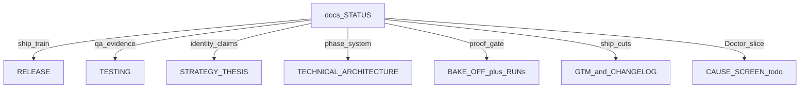

# MCP Watchdog — Status switchboard

**Last updated:** 2026-11-07  
**Role:** Bird’s-eye progress + doc routing. Domain SoTs stay authoritative for their slice; this file does **not** re-litigate thesis or architecture.

**Position (one line):** Phases **1–3 in tree**; eng bake-off **win** (35/36); published / tagging **0.5.7** (Doctor UI announce); soak ≥3 days before next announce-worthy cut.

---

## At a glance

| Dial | Now |
|------|-----|
| Claim ladder | Eng: **after bake-off win**. Marketing: **Now+** until 0.6.0 cut |
| GTM owner | **Instinct** — reach + comprehension ([GTM-ROLE.md](./GTM-ROLE.md)); Slack `#mcp-watchdog-gtm` + eng bot **live** ([GTM-COMMS.md](./GTM-COMMS.md)); iMessage = Vaibhav↔Instinct only (Cursor send off) |
| Product phases | **1–3 done in tree**; 4–6 deferred |
| Published vs tree | Marketplace + Open VSX **0.5.7** live (Doctor UI announce); HostCapabilities / verify in same VSIX — GTM beats still 0.5.8 / 0.5.9; **soak ≥3 days**; **no jump to 0.6.0 announce** |
| North-star metrics | Hooks exist (`DoctorMetrics`); **no public diagnose%/resolve%** |
| Falsification | Not triggered |

---

## Doc map (open the right file)

| Question | Open |
|----------|------|
| Where are we / what next? | **This file** |
| Staged publish / soak / tag gates | [RELEASE.md](./RELEASE.md) |
| Rigorous testing / live EH / capture sign-off | [TESTING.md](./TESTING.md) |
| Who are we / what can we claim? | [STRATEGY-THESIS.md](./STRATEGY-THESIS.md) |
| How is the system shaped? | [TECHNICAL-ARCHITECTURE.md](./TECHNICAL-ARCHITECTURE.md) |
| Doctor cause / fixtures | [design/CAUSE-CATALOG.md](./design/CAUSE-CATALOG.md) |
| Doctor UI / copy / live checks | [design/SCREEN-SPEC.md](./design/SCREEN-SPEC.md) · [../tasks/todo.md](../tasks/todo.md) |
| Competitive proof | [BAKE-OFF.md](./BAKE-OFF.md) · latest [RUN-2026-11-07-phase3-rebake.md](./validation/bake-off/RUN-2026-11-07-phase3-rebake.md) |
| Ship / marketing cuts | [GTM-PUBLISH.md](./GTM-PUBLISH.md) · [../CHANGELOG.md](../CHANGELOG.md) |
| What Instinct owns (GTM) | [GTM-ROLE.md](./GTM-ROLE.md) — reach, comprehension, RACI |
| GTM guardrails / no-spend / attribution | [GTM-GUARDRAILS.md](./GTM-GUARDRAILS.md) |
| Cursor ↔ Instinct how to talk | [GTM-COMMS.md](./GTM-COMMS.md) — Slack `#mcp-watchdog-gtm` via **MCP Watchdog Eng** bot; iMessage eng send **off** |
| Pre-tag secret scan | `bash scripts/check-no-secrets.sh` ([RELEASE.md](./RELEASE.md) hard gate) |
| Outsider narrative kit | [gtm/EXTERNAL-NARRATIVE.md](./gtm/EXTERNAL-NARRATIVE.md) |
| Agent skills allowlist | [AGENT-SKILLS.md](./AGENT-SKILLS.md) |
| Historical gates / raise / PLG | [EXECUTION.md](./EXECUTION.md) · [PRODUCT-DECISION.md](./PRODUCT-DECISION.md) · [PRODUCT-STRATEGY.md](./PRODUCT-STRATEGY.md) (superseded when they conflict) |

---

## Progress board

### Engineering phases

| Phase | Deliverable | Status |
|-------|-------------|--------|
| 1 | Doctor + RuntimeObservation + UI (SCREEN-SPEC) | Done in tree → **stage 0.5.7** (TESTING + soak) |
| 2 | HostCapabilities (cursor / vscode / windsurf) | Done in tree → **0.5.8** (fold announce if invisible) |
| 3 | verifyRecovery + incidents.jsonl + Overview Verified | Done in tree + re-bake → **0.5.9** then **0.6.0** announce |
| 4 | Cross-host patterns + golden fixtures | Not started |
| 5 | Compat / behavioural evidence engine | Not started (supporting later) |
| 6 | Harness CLI / team / optional proxy | Not started |

### 30-day validation

| Item | Status |
|------|--------|
| Days 1–5 competitive bake-off | Done (30/36 then Phase 3 re-bake **35/36**) |
| Doctor UI Must coding | Done ([tasks/todo.md](../tasks/todo.md)) |
| Live EH + release evidence ([TESTING.md](./TESTING.md)) | **READY** — [v0.5.7/SIGN-OFF.md](./validation/release-evidence/v0.5.7/SIGN-OFF.md); cut tagged / shipping |
| Heavy-user interviews | **Open** |
| Staged publish 0.5.7 → 0.5.9 → 0.6.0 ([RELEASE.md](./RELEASE.md)) | **0.5.7 published** — ≥3-day soak in progress; Instinct drafting Doctor UI announce; then 0.5.8 fold or 0.5.9 |
| Public diagnose% / resolve% | **Open** (after field data) |

---

## Maintenance rules (keep siblings honest)

Update **this file first** when position changes, then the owners below.

| When this lands | Also update |
|-----------------|-------------|
| Product identity / claim stage | STRATEGY claim ladder + this file |
| Phase / system behaviour | ARCH §13 + this file |
| Doctor cause / UI | CAUSE-CATALOG / SCREEN-SPEC / tasks/todo + this file |
| Bake-off run | BAKE-OFF results row + `validation/bake-off/RUN-*.md` + this file claim line |
| User-visible cut | TESTING sign-off → RELEASE gates → CHANGELOG + GTM + this file published-vs-tree; ping **Instinct** via [GTM-COMMS.md](./GTM-COMMS.md) for announce draft |
| Instinct asks for recording / stills | [TESTING.md](./TESTING.md) + [media/GIF-RECORDING.md](./media/GIF-RECORDING.md); reply via Slack eng bot + path / outcome |
| GTM pause / spend pause | This file + obey [GTM-GUARDRAILS.md](./GTM-GUARDRAILS.md) kill switch |
| Skill allowlist | AGENT-SKILLS only |

Agents: for “where are we / what next,” open **STATUS** first, then the domain SoT from the map. Before tag/publish work, open **RELEASE** + **TESTING**.

---

## Next 1–3 actions

1. Confirm Open VSX + Marketplace show **0.5.7**; G0 smoke on published Cursor; **≥3-day soak**; Instinct drafts Doctor UI announce (Now+) — do **not** jump to 0.6.0.  
2. Then 0.5.8 (or fold) → 0.5.9 (verify GIF) → soak → **0.6.0** announce via Instinct (Vaibhav A on Tier 2+ packet).  
3. Heavy-user interviews in parallel with soak.

---

## Do not (until this board says so)

- Collapse Unreleased into one production cut / skip TESTING sign-off  
- Phase 4–6 product work as the primary identity move  
- Required proxy / Cloud-first / JetBrains-first  
- Sixth UI state · Doctor wizard webview · sidebar illustrations  
- Public “best at recovery” / diagnose% without evidence  
- Claiming host healthy when `hostConnection` is Unknown  
