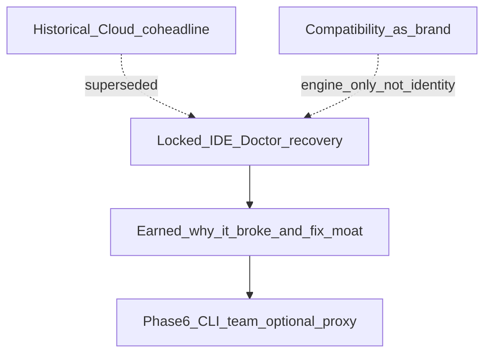
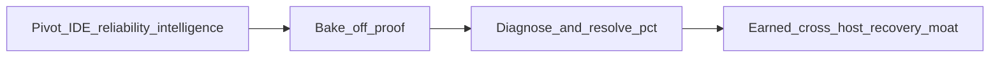
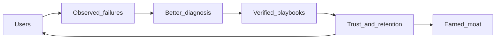
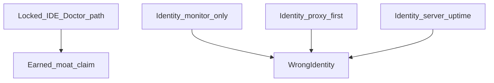
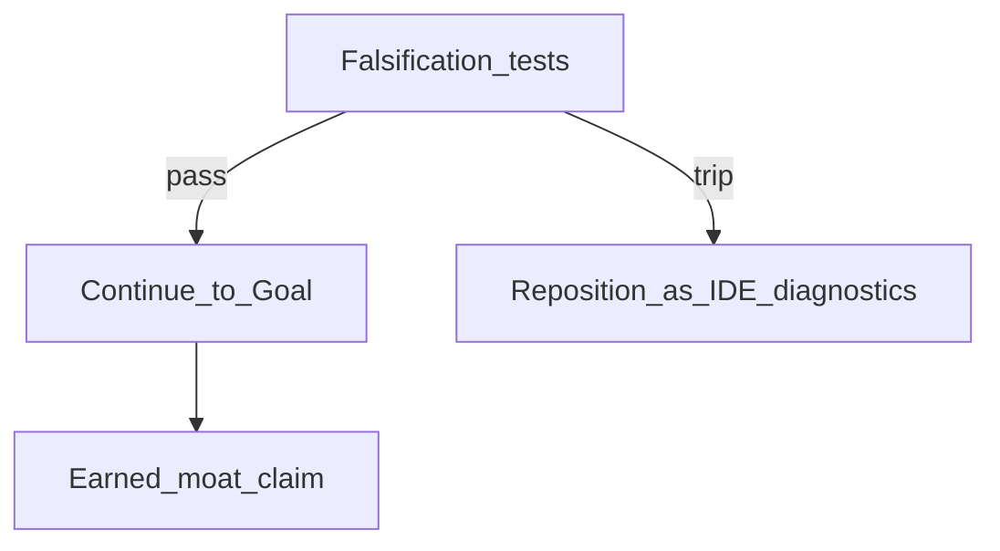

# MCP Watchdog — Strategy Thesis

**Status:** Locked product thesis (2026-11-07).  
**Progress / routing SoT:** [STATUS.md](./STATUS.md) (bird’s-eye — does not override this identity doc).  
**Engineering SoT for architecture:** [TECHNICAL-ARCHITECTURE.md](./TECHNICAL-ARCHITECTURE.md).  
**Evidence hygiene:** separate *verified evidence*, *competitor claims*, and *strategic inference*. Stars, forum posts, and vendor customer counts are not product-market fit.

This document is a **product thesis**, not a system-design report. Architecture detail lives in TECHNICAL-ARCHITECTURE.md.

---

## One-line company thesis

**Sticking point:** the moment an MCP integration breaks in the developer’s AI IDE.  
**Aspiration we will earn the right to claim:** exceptionally good at understanding *why* it broke and getting it working again — across hosts.  
**Discipline:** do not claim the aspiration early; treat it as the success bar until bake-off and measured diagnose%/resolve% make the claim true.

---

## Public identity

> **MCP Watchdog — the reliability and recovery intelligence layer for MCP integrations.**

| Layer | Statement |
|-------|-----------|
| Wedge | Continuous monitoring, Doctor, and guided recovery inside AI IDEs |
| Technical moat (target) | Cross-host operational intelligence, supported by protocol-aware compatibility and behavioural evidence |
| Data moat (target) | Growing, privacy-respecting corpus of diagnosed failures and verified recovery outcomes |
| Distribution moat | Trusted, local-first IDE workflow (Marketplace, Open VSX, GitHub) |
| Expansion | Phase 6 harness Doctor CLI; later Phase 7+ forge CLI (product→MCP) **delayed** — Instinct GTM research + interviews before build; team ops / upgrade protection / optional enforcement |

### Short copy

> MCP reliability, inside your AI IDE. Detect failures, understand what broke, recover without guessing.  
> States what independent checks can prove — and when editor connection state is **Unknown**. Never manufacture certainty.

### Strategic pivot → final goal

Historical raise/Cloud-coheadline and “compatibility as brand” are superseded for identity. Locked path is IDE Doctor + verified recovery; Cloud/team/proxy expand **after** the earned moat, not instead of it.

**Final-goal spine:** Pivot → bake-off proof → diagnose%/resolve% → earned cross-host recovery moat.

---

## Claim ladder (aspiration → earned claim)

Tied to **published versions** via [GTM-PUBLISH.md](./GTM-PUBLISH.md) release map (not every git commit).

| Stage | What we can say | Typical cut |
|-------|-----------------|-------------|
| **Now** | Independent probe + guided Fix; honest Unknown for host; help diagnose/recover (no moat boast) | ≤0.5.6 |
| **Now+** | Same + shipped Doctor cause-first UI / verify line when those versions ship — still **no** public diagnose% | **0.5.7–0.5.9** |
| **After competitive bake-off scored** | May cite dated totals in eng/docs (first run 30/36 Recover≤1) | Docs 2026-11-07 competitive |
| **After bake-off win** | Outperformed named alternatives on controlled failure scenarios (cite [BAKE-OFF.md](./BAKE-OFF.md) + [phase3 re-bake](./validation/bake-off/RUN-2026-11-07-phase3-rebake.md) **35/36**) — eng claim earned; marketing cut **0.6.0** | Eng: Phase 3 re-bake pass; announce **0.6.0** |
| **After measured diagnose%/resolve%** | “Correctly diagnoses X% / helps resolve Y% of tracked failures” (disclose false-positive rate) | Later 0.6.x+ |
| **After compounding proof** | Cross-host operational intelligence / recovery knowledge as a **true** differentiator | Later |

`CompoundingMoat` is the final public claim only when earned — not before bake-off + metrics. Per-cut marketing checklist: [GTM-PUBLISH.md](./GTM-PUBLISH.md).

**Never claim (even later if false):** only continuous MCP monitor · automatically fixes without evidence · knows host is healthy when Unknown · compatibility platform as sole identity.

**True when earned:** “best at understanding why MCP broke and getting it working.”

---

## Market position (pressure-tested)

### What is verified enough to act on

- MCP adoption in AI IDEs is meaningful (vendor telemetry and surveys are indicators, not censuses).
- Operator pain is real: silent disconnects, stale sessions, UI/desync, shared-process crashes, auth/credential failures wrapped in retry noise.
- Continuous monitoring is **not** an empty lane (Orbit, Bastion, Pacemaker, Observatory watch, mcpgawk, server-side monitors).

### Strategic inference

Compete on **quality of the answer after something breaks** + **verified recovery** + **host-honest dual truth** — not on “we also monitor.”

### Addressable customer

People actively using MCP in agent workflows — not registry server counts, and **not** “all IDE users.”  
Initial focus: **frequent MCP users**. Teams/fleet later.

Denominator for growth is **MCP operators**, not JetBrains primary-IDE share. Large IDE market share without MCP break-pain is not this product’s TAM.

### Where Watchdog exists (host coverage ladder)

Ship and distribute where MCP sessions actually fail for operators. Do **not** chase universal IDE coverage before Cursor penetration and harness reach are proven.

| Priority | Surface | Role | Plan phase |
|----------|---------|------|------------|
| **P0 — Own** | **Cursor** (+ Open VSX VS Code forks: Windsurf, Antigravity-class, VSCodium/Trae) | Beachhead: extension install, dual-truth Fix, Open VSX/Marketplace distribution | Now + eng Phase 2 adapters |
| **P0 — Supported** | **VS Code** (Microsoft) | Same extension binary; native MCP weakens some wedge — still supported | Now + Phase 2 |
| **P1 — Biggest missing seat** | **Claude Code–class terminal harnesses** (Claude Code, Codex, OpenCode, Pi, …) | High agent adoption; MCP clients outside the extension host. Need CLI / harness adapter (`doctor`/`status`, dual-truth vs harness), not Marketplace alone | Eng Phase 6 (spike earlier if Cursor GTM stalls) |
| **P2 — Later** | JetBrains IDEs | Large primary-IDE share; only after MCP-in-JB pain is evidenced like Cursor/Claude | After Phase 6 CLI patterns exist |
| **Out of wedge** | “Every IDE / every editor” | Dilutes Doctor + bake-off; not a growth lever | Never as Phase 1–3 driver |

**Growth inference:** Under-penetration of Cursor/Open VSX and **absence from terminal harnesses** lose more reachable MCP users than missing IntelliJ. Fix distribution on P0 before building P2.

**How we implement:** concrete adapters, config paths, CLI shape, and honesty rules → [TECHNICAL-ARCHITECTURE.md §9b](./TECHNICAL-ARCHITECTURE.md#9b-host-implementation-playbook-evidence-locked-2026-11-07) (Phase 2 IDE `HostCapabilities`; Phase 6 harness CLI). Do not invent host session APIs.

### Locked decision table

| Decision | Direction |
|----------|-----------|
| Product identity | Reliability + recovery intelligence for MCP integrations |
| Sticking point | Break moment in the AI IDE |
| Wedge | Monitoring + Doctor + guided recovery (non-invasive) |
| Core differentiator | Host-aware dual-truth diagnosis + verified recovery |
| Long-term moat (target) | Cross-host operational intelligence + recovery KB; compatibility engine supporting |
| North-star metrics | % failures correctly diagnosed · % of those successfully resolved · false-positive rate |
| Not north-star | Servers monitored count alone |
| Testing / contracts | Evidence under Doctor — not brand |
| Soft-stop | Honest warning; non-block of `tools/call` in direct mode |
| Proxy | Optional, default-off |
| Cloud / team | Later; free local reliability core |
| Monetisation | Free: checks, diagnosis, local history, safe recovery. Paid later: team history, fleet, policy, alerts, admin |

---

## Four reinforcing assets

A feature is not a moat. Value must **accumulate** with every diagnosed incident and every **verified** recovery.

| # | Asset | Role | Copyability |
|---|-------|------|-------------|
| 1 | Host-aware Doctor | Answer “why isn’t this working *in my editor right now?*” | Moderate |
| 2 | Cross-host failure + verified recovery KB | Quality of failure↔evidence↔diagnosis↔resolution (local-first; consent share) | Hard with time |
| 3 | Compatibility / evidence engine | Supporting — protocol, contracts, behavioural tests, confidence | Hard if mature |
| 4 | Local-first IDE workflow + distribution | Daily habit without required proxy | Harder once sticky |

Host adapters are valuable but **not permanently defensible** (hosts can ship better APIs). Keep them swappable.

### Compounding loop (hypothesis)

More users → more observed failures (with evidence + privacy) → better diagnosis → more verified playbooks → trust/retention → more users.  
Becomes a moat only if diagnose% and verified-resolve% improve measurably with usage.

### Deliberately not our moat

Prettier dashboard · generic Inspector · schema lockfiles alone · hosted gateway · huge matrix without behavioural evidence · proprietary config DB · chatbot that only explains logs.

---

## Competitive lanes (summary)

| Group | Examples | Implication |
|-------|----------|-------------|
| Near-direct runtime | See [BAKE-OFF.md](./BAKE-OFF.md) pinned set (Bastion proxies, Pacemaker bridge, Orbit+companion, Workbench discover/test, mcpgawk) | Monitoring occupied; recovery often needs proxy/bridge |
| Testing / lock / CI | MCPJam, Observatory, official Inspector | Do not brand as testing/lock platform |
| Server-side monitors | Merlonix, Spanly, MCPVault Monitor, Elva MCP Monitor | Server healthy ≠ this IDE session healthy |

**Hands-on bake-off** is the first proof gate before moat claims. Method, scenarios, scoring: [BAKE-OFF.md](./BAKE-OFF.md).

Compare near-direct tools without adopting their identity. Monitor-only, proxy-first, or server-side-uptime as **brand** are wrong endpoints.

---

## Product sequence

| Phase | Build | Proves | Status (2026-11-07) |
|-------|-------|--------|---------------------|
| 1 | Doctor + multi-layer RuntimeObservation (+ UI per SCREEN-SPEC) | Identify what actually failed | In tree (UI Must); publish cut **0.5.7** |
| 2 | Host adapters + supported recovery (**Cursor / VS Code / Windsurf**; Antigravity-class when vscode-compatible) | Act on the diagnosis in the IDE beachhead | In tree (`HostCapabilities`); publish cut **0.5.8** |
| 3 | Recovery verification + local incident history | Know whether fixes work | In tree + re-bake Recover=2; publish cut **0.5.9** / announce **0.6.0** |
| 4 | Cross-host patterns + golden fixtures | Improve with accumulated evidence | After 0.5.9 |
| 5 | Compatibility + behavioural evidence engine | Predict upgrade regressions | Supporting |
| 6 | **Harness / CLI surface** (`doctor`/`status` for Claude Code–class MCP clients) + optional team/enforcement | Reach MCP operators outside the extension host | After IDE proof |

**30-day validation:** Days 1–5 bake-off **done**; Doctor UI Must + Phase 2–3 **shipped in tree**; Phase 3 re-bake **pass** (35/36, Recover=2 on S1–S5). Marketing win announce waits for **0.6.0**. Release map: [GTM-PUBLISH.md](./GTM-PUBLISH.md).

Phase 6 harness/CLI expands **after** Doctor + IDE adapters earn proof — it is not a shortcut around bake-off. A thin CLI spike is allowed earlier only as a **distribution experiment**, not a brand pivot.

**Phase 7+ Expansion (delayed) — forge CLI:** Candidate idea only: if a product has a local CLI but no MCP, a future `mcp-watchdog` subcommand could emit an allowlisted stdio MCP wrapper, write an `mcp.json` entry, then run the same Doctor loop on that wrapper. This is **adjacent** to Doctor (create then doctor), not the brand for Phases 1–6. **Do not build** until Phase 6 Doctor CLI is real **and** Instinct completes fresh market research + customer interviews (go/no-go; Vaibhav A if spend). Do not conflate with Phase 6 (doctor existing harness MCP configs). OpenAPI codegen and unrestricted bash are out of the first wedge. Status board: [STATUS.md](./STATUS.md).

**Competitor (hands-on):** Bastion closest (25/36) on 401/ENOENT status; compete on cause taxonomy + dual-truth + verified Fix — not reconnect alone.

```mermaid
flowchart LR
  P1[P1_Doctor_observation]
  P2[P2_Host_adapters]
  P3[P3_Verify_plus_KB]
  P4[P4_Cross_host_patterns]
  P5[P5_Compat_engine]
  P6[P6_CLI_team_enforce]
  Goal[Earned_moat_claim]
  P1 -->|"identify_failure"| P2
  P2 -->|"act_on_diagnosis"| P3
  P3 -->|"know_fixes_work"| P4
  P4 -->|"improve_with_evidence"| P5
  P5 -->|"predict_regressions"| Goal
  Goal --> P6
```

---

## Falsification tests

Change thesis if:

- Failures are mostly upstream outages Watchdog cannot affect  
- Host-native state stays inaccessible on editors that matter  
- No return after setup / first failure  
- Bastion/Pacemaker win recurring problems and users accept wiring cost  
- Users prefer manual Inspector over continuous Doctor  
- Diagnose%/resolve% do not improve with usage  

→ reposition as IDE diagnostics/troubleshooting, not reliability intelligence layer.

---

## North-star metrics (v0 formulas)

Instrument after Doctor taxonomy ships; do not claim X%/Y% until labeled. Track false positives separately — wrong recovery path destroys trust faster than a missing dashboard.

| Metric | Formula (v0) | Notes |
|--------|--------------|-------|
| **diagnose%** | `# failures with causeId matching human/fixture label` ÷ `# labeled failures in window` | Window = bake-off run or rolling local IncidentRecords with labels. Unlabeled rows excluded from denominator. |
| **verified-resolve%** | `# incidents with verifiedOutcome=resolved` ÷ `# incidents where a recovery action was attempted` | Must pass post-Fix re-observe (ARCH verify loop). Host Unknown alone does not count as resolved. |
| **false-positive rate** | `# diagnoses where causeId ≠ label` ÷ `# labeled failures` | Includes overconfident `generic` when a sharper class applied. Disclose alongside diagnose%. |

**Ground truth:** bake-off fixture labels first; later optional user “Was this right?” on Fix flows. Product telemetry must not store secret-bearing error strings when computing these.

---

## Relationship / authority

| Document | Role |
|----------|------|
| [STATUS.md](./STATUS.md) | Progress / routing switchboard (where we are; what to update) |
| **This file** | Product identity SoT |
| [TECHNICAL-ARCHITECTURE.md](./TECHNICAL-ARCHITECTURE.md) | Engineering SoT Phases 1–3+ |
| [design/CAUSE-CATALOG.md](./design/CAUSE-CATALOG.md) | Doctor fixture / logic SoT (`causeId` rows + GWT) |
| [design/SCREEN-SPEC.md](./design/SCREEN-SPEC.md) | Doctor UI SoT (copy, surfaces, design language, live checks) |
| [BAKE-OFF.md](./BAKE-OFF.md) | Competitive proof method |
| [GTM-ROLE.md](./GTM-ROLE.md) / [GTM-GUARDRAILS.md](./GTM-GUARDRAILS.md) / [GTM-COMMS.md](./GTM-COMMS.md) | External reach + claim/spend/attribution blast radius (does not override this thesis) |
| [gtm/EXTERNAL-NARRATIVE.md](./gtm/EXTERNAL-NARRATIVE.md) | Living outsider wording — claim lines still gated by this ladder |
| [TECHNICAL.md](./TECHNICAL.md) | Historical dense dump (**demoted** — see its banner; not primary shipped SoT) |
| [PRODUCT-DECISION.md](./PRODUCT-DECISION.md) / [PRODUCT-STRATEGY.md](./PRODUCT-STRATEGY.md) / [EXECUTION.md](./EXECUTION.md) | Historical raise / PLG / gates — superseded when they conflict |
| [architecture/SCAN-2026-11-07.md](./architecture/SCAN-2026-11-07.md) | Focus debt map vs Architecture 0 |

---

## North-star reminder

An incorrect diagnosis that sends a developer down the wrong recovery path destroys trust faster than a missing dashboard feature.
