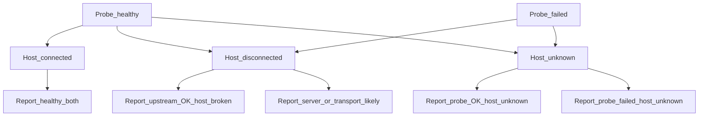
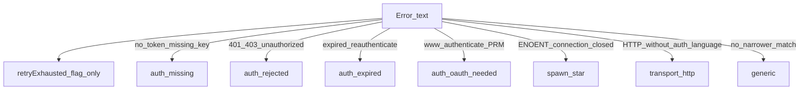
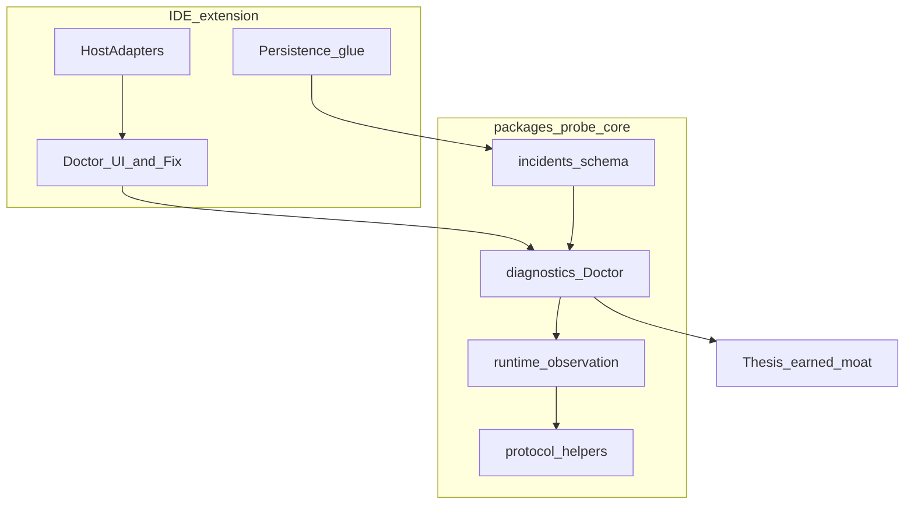
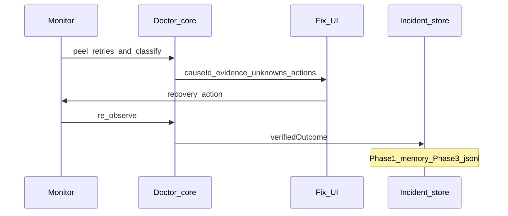
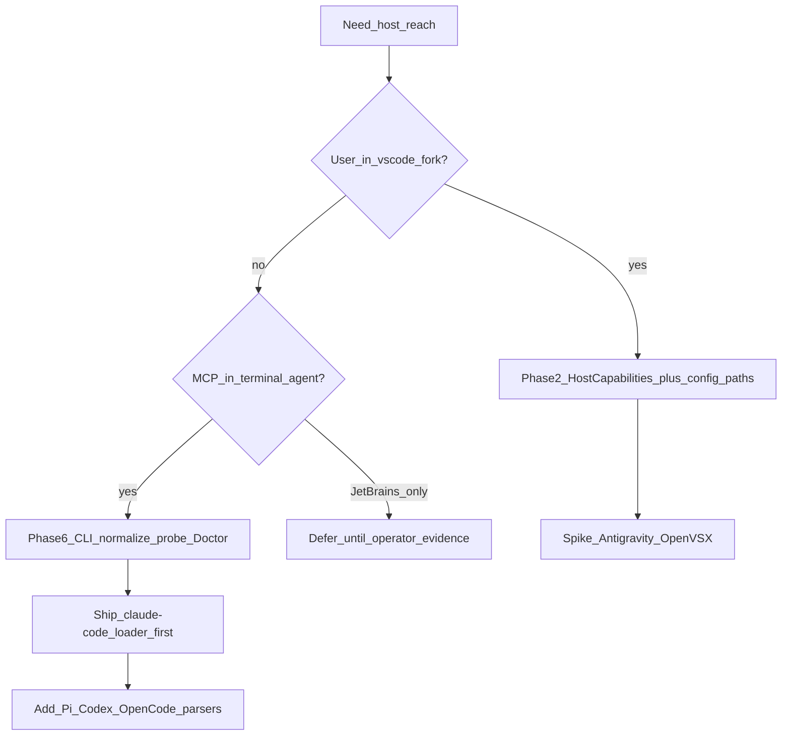
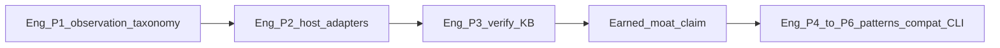

# MCP Watchdog — Technical Architecture

**Status:** Target architecture for Phases 1–3 (Doctor → host adapters → verified recovery).  
**Progress board:** [STATUS.md](./STATUS.md) (phase checkmarks / next actions — not a substitute for this system SoT).  
**Product thesis:** [STRATEGY-THESIS.md](./STRATEGY-THESIS.md).  
**Shipped behaviour reference:** [TECHNICAL.md](./TECHNICAL.md) (0.x as built).  
**Method:** repository Architecture 0 from code + system-design reasoning (clarify → quantify → evolve A0 → stress-test → debt). Not a greenfield rewrite.

**Observed tree (Architecture 0):** `src/` (extension host), `packages/probe-core/` (vscode-free shared), `packages/cloud/` (optional bridge/preview). Extension version at write: **0.5.6**.

---

## 0. Anti-overengineering gate

| Factor | Envelope |
|--------|----------|
| Users | Single developer workstation |
| Servers monitored | Typically 1–20 MCP configs |
| Probe cadence | Seconds–minutes (interval + jitter) |
| Persistence | Local workspace / globalState; no multi-region |
| Consistency | Single-process authority in the extension host |

**Gate result:** Do **not** introduce distributed stores, message buses, or required proxies for v1 Doctor. Evolve the existing extension + probe-core. Distributed/cloud designs stay Phase 6 / later.

---

## 1. Architecture 0 — what the repo already is

### In-scope ownership

| Component | Owns | Evidence |
|-----------|------|----------|
| `src/extension.ts` | Activation, wiring, commands, toast/Accept/Fix/Remove | entry |
| `src/monitor.ts` | Independent MCP probe lifecycle, states, retries, tool/schema drift hooks | `ServerState`, `ServerStatus` |
| `src/config-core.ts` + `src/config.ts` | mcp.json discovery/merge, vscode-free vs host glue | workspace rule: core sans vscode |
| `src/trust.ts` | Approval before spawn/HTTP | trust gate |
| `src/failureTriage.ts` + `src/triageHost.ts` | Failure class + Fix steps + execution | `FailureClass` |
| `src/authError.ts` | Display rewrite for 401 / AWS session text | classifyProbeError |
| `src/editorMcp.ts` | Best-effort `workbench.mcp.*` restart | often unavailable on Cursor |
| `src/incidents.ts` | In-memory ring buffer of state transitions | export Markdown |
| `src/vendorRecipes.ts` + `src/credentialOverlay.ts` | Optional vendor overlays / SecretStorage | Exa/AWS-shaped |
| UI (`statusBar`, `serversTree`, `overviewView`) | Derived presentation of monitor state | five states only |
| `packages/probe-core` | Fingerprint, normalize, diffTools, bridge scrub/schema, HTTP check ids | no `vscode` import |
| Telemetry (`src/telemetry/*`) | Scrubbed product analytics | never env/header values |
| `packages/cloud` | Optional names-only bridge / preview | adjacent, not Doctor path |

### Settled constraints (preserve)

1. **Dual-truth:** Watchdog probe ≠ editor MCP client health. Never claim host healthy when unobserved.  
2. **`packages/probe-core` and `config-core` stay importable without `vscode`.**  
3. UI summary states exactly: `connecting | healthy | degraded | failed | disconnected`.  
4. Never log or render env/header **values** (names OK).  
5. Only runtime dep today: `@modelcontextprotocol/sdk` (ask before adding more).  
6. Trust gate before spawn/connect when configured.

### Pressure on A0 (debt → Phase 1+)

| Finding | Cost | Evidence | Remedy |
|---------|------|----------|--------|
| Auth Doctor misses “No token provided” style errors | Wrong Fix path → `generic` | `failureTriage.ts` matches mainly 401; `authError.ts` same | Agnostic `auth.missing` / `rejected` / `expired` taxonomy |
| “Max retries” can dominate user-facing error | Root cause buried | `resolveFailureText` peels retries; UI still shows Failed/Accepted weakly | Surface cause + `retryExhausted` flag |
| Host connection often unobserved | Cannot answer “broken in *my* editor” | `editorMcp` best-effort; no native status API | `hostConnection: unknown` explicit; adapters when APIs exist |
| Incidents are ephemeral | No learning / verify loop | `IncidentRingBuffer` capacity 200, memory only | Persist local incident records with verified outcome |
| Single health enum as mental model | Collapses dimensions | `ServerState` drives chip | Derive UI state from `RuntimeObservation` |
| Recipes before agnostic class | Special-casing risk | `vendorRecipes` in Fix path | Classify first; recipe overlays second |

---

## 2. Requirements (scoped)

### Functional (must)

1. Continuously probe configured MCP servers (stdio / Streamable HTTP / SSE as supported).  
2. Present **multi-dimension** observation (not only green/red).  
3. On failure: **Doctor** answers what failed, evidence, unknowns, least-disruptive action.  
4. Execute guided recovery when host capabilities allow; **re-probe to verify**.  
5. Persist local incident history (cause, evidence, action, verified outcome).  
6. Keep dual-truth honest when host state is Unknown.

### Non-functional

| Attribute | Target |
|-----------|--------|
| Probe overhead | Prefer short-lived connect→ping→close (interval mode); bound concurrency |
| Privacy | Secrets never in logs/UI/evidence/export; share opt-in only |
| Latency of Doctor | Interactive (&lt; few seconds after failure known) |
| Correctness bar | Prefer Unknown / inconclusive over false certainty |
| False-positive cost | High — wrong diagnosis tracked as FP |

### Out of scope (Phases 1–3)

- Required proxy / gateway (Bastion-class) as default  
- Cloud fleet as primary product  
- Full MCPJam-style eval workbench  
- Claiming native Cursor session health without an API  

---

## 3. System model

### Entities

| Entity | Identity | Notes |
|--------|----------|-------|
| ServerConfig | name + config origin | From merged mcp.json layers |
| RuntimeObservation | server + observedAt | Multi-dimension snapshot |
| Diagnosis | observation + causeId + confidence | Derived |
| RecoveryAction | id + host capability | e.g. retry.probe, restart.editorMcp |
| IncidentRecord | id | Local KB row |
| ContractSnapshot | server + fingerprints | Phase 5; soft-stop later |
| EvidenceRecord | id | Links tests/observations to claims |

### Invariants

1. UI `ServerState` is **derived** from observations — never invent a sixth state for auth.  
2. If host connection cannot be observed → `hostConnection = unknown` (never fabricate Connected).  
3. Secrets and header/env **values** never persist in IncidentRecord / EvidenceRecord.  
4. A recovery is not “successful” until a verification observation says so.  
5. Probe-core remains vscode-free.  
6. Retry exhaustion is a **lifecycle flag**, not a root cause.

### Interfaces (boundaries)

| Boundary | Style | Owner | Failure |
|----------|-------|-------|---------|
| Monitor → MCP server | MCP SDK transports | probe/monitor | timeout, auth, spawn, protocol |
| Doctor ← Observation + config + host adapter | pure functions in core where possible | diagnostics | inconclusive |
| Host adapter → editor | vscode commands / future APIs | extension glue | Unavailable → Unknown |
| Incident store | workspace file or VS Code state | storage iface | degrade to memory |
| Telemetry / consent-share | scrubbed events | telemetry | opt-out; share separate consent |

### Sources of truth

| Data | Authority |
|------|-----------|
| mcp.json configs | Files on disk (merged) |
| Probe health | Watchdog monitor process |
| Editor session health | Host only (often Unknown) |
| Accepted failures | Workspace globalState (presentation) |
| Incident history | Local Watchdog store (Phase 3) |
| Credentials | OS/env/SecretStorage — never Watchdog DB |

---

## 4. RuntimeObservation + Doctor

```ts
interface RuntimeObservation {
  configuration: 'valid' | 'invalid' | 'unknown';
  process: 'running' | 'exited' | 'not_applicable' | 'unknown';
  transport: 'connected' | 'disconnected' | 'unknown';
  protocol: 'compatible' | 'incompatible' | 'unknown';
  discovery: 'success' | 'failed' | 'unknown';
  auth: 'not_required' | 'ok' | 'missing' | 'rejected' | 'expired' | 'unknown';
  hostConnection: 'connected' | 'disconnected' | 'unknown';
  execution: 'successful' | 'failed' | 'not_tested';
  retryExhausted: boolean;
  observedAt: string; // ISO
}
```

### Dual-truth product law

| Probe | Host | Report |
|-------|------|--------|
| Healthy | Connected | Healthy (both) |
| Healthy | Disconnected | Upstream OK; host broken |
| Failed | Disconnected | Server/transport likely |
| Healthy | Unknown | Probe OK; host unknown |
| Failed | Unknown | Probe failed; host unknown |



### Doctor five questions

1. What failed?  
2. What evidence supports that?  
3. What is still unknown?  
4. What is the least disruptive next action?  
5. Did that action restore the integration? (**verify**)

---

## 5. Agnostic auth / credential taxonomy

Classifier is **server-name agnostic**. Vendor recipes overlay after class is known.

| Cause id | Signals (examples) | Recovery |
|----------|--------------------|----------|
| `auth.missing` | no token / missing api key / provide a valid token | Open config (names only); credential wizard |
| `auth.rejected` | 401, 403, unauthorized, invalid token | Re-enter credential; optional login URL |
| `auth.expired` | expired, reauthenticate, session expired | Refresh/login (AWS session = recipe of expired) |
| `auth.oauth_needed` | www-authenticate, PRM | Discover HTTPS auth endpoint |
| `transport.http` | Streamable HTTP / SSE errors without auth language | URL/network; Show Log |
| `lifecycle.retry_exhausted` | Max retries | Attach to underlying cause — never sole diagnosis |
| `spawn.*` | ENOENT, connection closed | Path/command/cwd |
| `generic` | residual | Show Log + open config |



`lifecycle.retry_exhausted` attaches to the underlying cause — never the sole root diagnosis.

**Fixture requirement:** same “No token provided…” text for servers `posthog` and `acme` → same `auth.missing` class. Recipe may add docs link; class unchanged. Unit fixtures must live under `test/unit/` when Phase 1 lands.

### FailureClass → causeId migration (Phase 1)

| Today (`FailureClass`) | Target `causeId` | Rule |
|------------------------|------------------|------|
| `aws_session` | `auth.expired` (+ recipe overlay for AWS login copy) | Prefer expired class; recipe supplies terminal step |
| `auth` | Split: `auth.rejected` if 401/403/unauthorized; `auth.missing` if missing/no token language; `auth.oauth_needed` if WWW-Authenticate/PRM | Never leave bare `auth` after Phase 1 |
| `spawn` | `spawn.enoent` / `spawn.closed` (keep under `spawn.*`) | |
| `generic` | `generic` only after all narrower matchers fail | |

Ship a **compat shim** mapping old telemetry enum → new causeId for one minor so dashboards do not break silently. Classifier is server-name agnostic; `vendorRecipes` run **after** class.

Widen today’s `classifyFailure` / `isAuthRequiredError` accordingly (implementation Phase 1).

---

## 5b. Phase 1 behavioral contracts (Doctor)

Types alone are not enough. Phase 1 must implement:

| Contract | Behaviour |
|----------|-----------|
| **Observation build** | After each probe attempt, construct `RuntimeObservation` from monitor outcomes (transport/protocol/discovery/auth/retryExhausted). Unobserved host → `hostConnection: 'unknown'`. |
| **Doctor pure API** | `diagnose(observation, errorText, configMeta) → { causeId, confidence, evidence[], unknowns[], actions[] }` in vscode-free code (probe-core). Answers the five questions; UI only renders. |
| **Confidence** | `high` if matcher specific; `medium` if heuristic; `low` if `generic` or conflicting signals. Prefer Unknown/inconclusive over false certainty. |
| **Derive UI state** | `deriveServerState(observation, diagnosis) →` exactly one of the five UI states. **Never** add a sixth state for auth. Mapping: connecting while first probe in flight; failed when transport/discovery/auth failed; degraded for partial (e.g. discovery ok but execution failed / soft issues); healthy when probe dimensions ok (host may still be unknown); disconnected when process exited / not configured. Host Unknown does **not** force failed. |
| **Verify loop** | After any Fix action that claims recovery: re-probe once → if discovery/transport healthy enough for the scenario, `verifiedOutcome: 'resolved'`; if worse, `'worsened'`; if still failing, `'unresolved'`; if cannot tell, `'unknown'`. Do not mark resolved solely because a command ran. **Phase 1:** compute `verifiedOutcome` in memory (and optional Markdown export). **Phase 3:** append durable `IncidentRecord` rows. Metrics may use bake-off labels before persistence exists. |
| **Packaging (locked)** | Phase 1 moves **types + diagnose/taxonomy/redaction helpers** into `packages/probe-core`. **`monitor.ts` stays in `src/`** until Phase 1 green; extract later if CLI needs it. vscode stays in `triageHost` / `extension` / UI. |

---

## 6. Incident knowledge base (local-first)

```ts
interface IncidentRecord {
  id: string;
  serverName: string;
  hostId: string;           // cursor | vscode | windsurf | unknown
  hostVersion?: string;
  protocolVersion?: string;
  transport: 'stdio' | 'http' | 'sse' | 'unknown';
  serverImplementation?: string; // name only, no secrets
  causeId: string;
  evidenceSummary: string;  // redacted
  observation: RuntimeObservation;
  actionsAttempted: { actionId: string; at: string }[];
  verifiedOutcome: 'resolved' | 'unresolved' | 'unknown' | 'worsened';
  verifiedAt?: string;
  createdAt: string;
}
```

- **Default store (locked for Phase 3):** workspace-local append-only `.mcp-watchdog/incidents.jsonl` (create dir on first write). Fallback to in-memory ring if workspace unwritable. Do **not** put incident bodies in SecretStorage.  
- **Redaction before persist/export:** run the same scrub used for bridge (`REJECTED_PAYLOAD_KEYS` + strip env/header **values** + redact URL userinfo/query token-like params) on `evidenceSummary` and any stored error text. Prefer causeId + observation flags over raw `lastError` when unsure.  
- Minimum row: `id`, `serverName`, `causeId`, `observation`, `verifiedOutcome`, `createdAt`. Drop/omit rows missing causeId or observation.  
- Any upload for cross-host learning: **explicit consent**, scrubbed, separate from product telemetry.  
- Quality ≫ quantity: incomplete labels are worse than fewer rows.

---

## 7. Recommended architecture (evolution of A0)

**Candidate R1 — Non-invasive reliability companion (recommended)**

```text
IDE Extension (surfaces)
  ├── HostAdapters (swappable) ── workbench.mcp.* / future APIs / Unknown
  ├── Doctor UI + Fix flow
  └── Persistence glue
         │
packages/probe-core (shared)
  ├── protocol / probe helpers (existing + expand)
  ├── diagnostics/ (taxonomy, Doctor pure logic)
  ├── runtime/ observations + derive ServerState
  ├── incidents/ schema + redaction
  └── contracts/ + testing/ (Phase 5; soft-stop later)
```

Engineering shape that serves the thesis goal (earned diagnose + verified recover) — **not** Cloud-first.



| Choice | Solves | Worsens | Change when |
|--------|--------|---------|-------------|
| Independent probe + Unknown host | Honesty; works without host APIs | Cannot always verify editor session | Host ships reliable status API → adapter fills Connected/Disconnected |
| Doctor in probe-core (+ thin IDE glue) | Reuse for CLI later; test without VS Code | Extra extraction discipline | — |
| Local incident file/state | Verified recovery loop; privacy | No cross-machine learning until consent | Team/cloud demand + consent UX |
| Optional proxy later | Enforcement / wire evidence | Trust friction; Bastion overlap | Users reject non-invasive recovery |

### One-line rejections

- **Required proxy-first (Bastion-like):** closed for Phases 1–3 — high friction; revisit Phase 6.  
- **Rewrite as cloud-first monitor:** contradicts distribution moat and envelope.  
- **Compatibility platform as primary architecture:** contested market; engine-only.

---

## 8. Critical flows

### Happy path — continuous probe

Config load → trust check → schedule probe → connect/ping/(optional listTools) → update observation → derive UI state → (optional) soft-stop contract check later.

### Failure → Doctor → recover → verify

1. Probe fails or host reports disconnected (if known).  
2. Peel retry wrappers; classify cause (agnostic).  
3. Doctor presents evidence + unknowns + actions.  
4. User (or guided step) runs recovery.  
5. Re-observe; set `verifiedOutcome`; append IncidentRecord.  
6. If unresolved, escalate least-disruptive next action (restart editor MCP → reload window).



### Auth missing (Streamable HTTP)

Connect POST → server: “No token provided” → transport error envelope → retries exhausted → Doctor: `auth.missing` + `retryExhausted` → open config / wizard → retry probe → verify discovery.

### Resilience notes (from failure skill)

- Timeouts on every probe; backoff + jitter already in monitor options.  
- Avoid retry storms: bound retries; don’t stampede all servers on wake.  
- Degradation: show Unknown rather than green when evidence insufficient.  
- Circuit-style: flap detection already consolidates alerts — keep.

---

## 9. Host adapters

```ts
interface HostCapabilities {
  hostId: string;
  hostVersion?: string;
  canReadMcpConfig: boolean;
  canObserveConnectionState: boolean;
  canRestartServer: boolean;
  canRestartWindow: boolean;
  canAccessToolCatalog: boolean;
}
```

Default unknown for native connection.

**Host coverage (aligned with [STRATEGY-THESIS.md](./STRATEGY-THESIS.md) ladder):**

| `hostId` (target) | Status (Phase 1–3) | Notes |
|-------------------|--------------------|-------|
| `cursor` | **supported** | Primary beachhead; Open VSX |
| `vscode` | **supported** | Marketplace; Unknown `hostConnection` OK |
| `windsurf` | **experimental** | Same vscode extension host assumptions |
| `antigravity` (or vscode-fork) | **unknown** until spike | Code-OSS + Open VSX ([Antigravity MCP](https://antigravity.google/docs/mcp/)); same VSIX + gemini/`mcp_config.json` layers — see §9b |
| `claude-code` / `codex` / `opencode` / `pi` | **unsupported** in extension | Phase 6 CLI per §9b; configs are public, session APIs are not |
| `jetbrains` | **unsupported** | After harness CLI patterns + evidence of MCP operator pain |

Implement Cursor / VS Code / Windsurf adapters in Phase 2; replace assumptions when hosts improve APIs. Do not block Phase 1–3 on JetBrains or terminal harnesses.

### 9b. Host implementation playbook (evidence-locked, 2026-11-07)

**Rule:** Independent probe via MCP SDK remains SoT for upstream health. Host session state defaults to `unknown` unless a **documented** status API or CLI exists. Do not invent Cursor/Claude internal APIs.

Sources consulted: [Cursor MCP docs](https://cursor.com/docs/mcp) · [Cursor forum status-API request](https://forum.cursor.com/t/show-mcp-server-status-in-status-bar-or-expose-api-to-extensions/135962) · [Claude Code MCP](https://code.claude.com/docs/en/mcp) · [Pi MCP](https://pi.dev/docs/latest/mcp) · [Antigravity MCP](https://antigravity.google/docs/mcp/) · HF harness MCP cheat-sheet (Claude/Codex/OpenCode/Pi config shapes).

#### Phase 2 — IDE `HostCapabilities` (extension)

| Step | What to build | Evidence / constraint |
|------|----------------|------------------------|
| 2.1 Detect `hostId` | Map `vscode.env.appName` / appRoot heuristics → `cursor` \| `vscode` \| `windsurf` \| `antigravity` \| `unknown` | Forks differ; keep table-driven |
| 2.2 Wrap existing glue | One adapter module per host calling shared `editorMcp.ts` + config loaders; fill `HostCapabilities` | Today: best-effort `workbench.mcp.*` only |
| 2.3 `canObserveConnectionState` | **Always false** on Cursor until public API ships; VS Code: still false unless we adopt a **documented** MCP contrib API (internal `mcp.*` context keys are **not** a product API — forum request proves gap) | Cursor: `vscode.cursor.mcp.registerServer` is **registration only**, not status |
| 2.4 `canRestartServer` | Probe `getCommands()` for `workbench.mcp.restartServer` / `startServer` / `listServer` (already in `editorMcp.ts`) | Cursor/many forks: unavailable → Fix offers Reload Window only |
| 2.5 Config layers (IDE) | Keep merge order; add Antigravity/Gemini paths when spike confirms: `~/.gemini/config/mcp_config.json`, workspace `.agents/mcp_config.json`; optional Antigravity app `mcp.json` under Application Support | Antigravity = Code-OSS + Open VSX → **same VSIX**, not a new binary |
| 2.6 Dual-truth UI | Probe healthy + `hostConnection: unknown` stays valid; never show editor “Connected” from Watchdog alone | Thesis honesty |

**Antigravity spike (cheap):** Install Open VSX build in Antigravity → confirm extension activates → confirm whether `workbench.mcp.*` exists → add config path readers → flip §9/`§12` cell `unknown` → `experimental` or `supported`.

#### Phase 6 — Harness / CLI (probe-core reuse)

Terminal agents are MCP **clients** with their own config files and CLIs. Product shape: `mcp-watchdog` **CLI** (or `npx`) that loads harness configs, runs the same Doctor/probe as the extension, prints causeId + Fix steps. Optional later: thin MCP *server* that exposes Watchdog status tools into the harness — only after CLI proves value.

| Harness | Config to read (normalize → probe-core server records) | Host-status signal (optional honesty) | Recovery actions we can recommend |
|---------|--------------------------------------------------------|----------------------------------------|-----------------------------------|
| **Claude Code** | Project `.mcp.json` (`mcpServers`); user/local in `~/.claude.json` (scopes per docs). **Gap today:** extension already reads `~/.claude.json` but **not** project `.mcp.json` | Shell-out `claude mcp list` / `claude mcp get <name>` when `claude` on PATH; else `hostConnection: unknown`. In-session `/mcp` is **not** automatable as a stable API | Re-probe; tell user to re-approve project servers; `claude mcp remove`/`add`; fix env/token; do **not** claim we restarted Claude’s client |
| **Pi** | `~/.pi/agent/mcp.json`, `.pi/mcp.json` (and adapter paths `~/.config/mcp/mcp.json`, `.mcp.json` per Pi docs) | `pi mcp list` when available | Same Doctor; point to `/mcp` + `/reload` in Pi |
| **Codex** | `~/.codex/config.toml` / `.codex/config.toml` → `[mcp_servers.<name>]` TOML → JSON shape | `codex mcp …` if present | Same |
| **OpenCode** | `opencode.json` → `mcp.<name>` with `type: local\|remote`, `command[]`, `environment` | No universal status CLI assumed | Convert local→stdio / remote→HTTP then probe |

```text
packages/probe-core/     diagnose, taxonomy, RuntimeObservation (done Phase 1)
src/config-core.ts       normalize Cursor/VS Code/Claude Desktop shapes (extend)
bin/mcp-watchdog.mjs     NEW Phase 6: load configs → probe → print JSON/text report
  --host claude-code|pi|codex|opencode|auto
  --cwd <project>
  (never print env/header values)
```

**Normalize once:** every harness adapter outputs the same internal `McpServerConfig` list the monitor already understands (stdio `command`/`args`/`env`, HTTP `url`/`headers` names-only). Claude Code requires `"type": "http"` on URL entries — parser must not treat bare `url` as stdio (Claude docs: that is a config error).

**Verify loop:** CLI re-probes after user applies Fix; `verifiedOutcome` in memory (Phase 3 persistence optional for CLI via cwd `.mcp-watchdog/incidents.jsonl`).

**Explicit non-goals for Phase 6 v1:** injecting into Claude/Pi process memory; scraping TUI `/mcp`; JetBrains plugin; claiming harness session health without CLI status.

#### Decision tree (what to ship when)



---

## 10. Module map (target — extract when justified)

```text
packages/probe-core/src/
  protocol/      client helpers, transports (as extracted)
  diagnostics/   doctor, failure-taxonomy, recommendations
  runtime/       observation model, derive ServerState
  incidents/     record schema, redaction helpers
  contracts/     canonicalize, fingerprint, versioning   (Phase 5)
  compatibility/ rules, confidence                       (Phase 5)
  testing/       ExecutionPolicy, fixtures               (Phase 5)
  evidence/      EvidenceRecord                          (Phase 5)
  bridge/        existing scrub/schema
  schema/        existing normalize/diff
```

Do not create empty trees day one. Extension keeps vscode API in thin glue files per workspace rules.

---

## 11. Soft-stop and proxy (later)

- **Soft-stop:** `contractStatus` can warn while probe is healthy; does not block `tools/call` in direct mode.  
- **Proxy (P2):** fail-closed optional enforcement of approved input contracts; never silent mcp.json rewrite.

---

## 12. Protocol / transport matrix (planning artifact)

| Dimension | Phase 1–3 default | Notes |
|-----------|-------------------|-------|
| Protocol | **Handshake-era `2025-11-25`** (supported) | Modern `2026-07-28` (stateless / no initialize) = **unknown** until spike; owner = probe-core maintainer; exit = SDK can speak modern or we document unsupported |
| Transport | stdio + Streamable HTTP **supported**; SSE **experimental** | Prefer Streamable when configuring HTTP |
| Auth | none + bearer missing/rejected/expired **supported** (taxonomy); OAuth/PRM **experimental** | |
| Host | Cursor + VS Code **supported** (Unknown hostConnection OK); Windsurf **experimental**; Antigravity-class fork **unknown** until spike; Claude Code / Pi / Codex harnesses **unsupported** until Phase 6 CLI | See §9 ladder; TAM = MCP operators not all IDEs |

Fill cells as `supported | experimental | unsupported | unknown` when spike evidence lands. Cloud pin `2025-11-25` stays until Cloud is in scope again.

---

## 13. Implementation sequence (engineering)

Living checkmarks / next actions: [STATUS.md](./STATUS.md). Detail remains in this table.

| Phase | Deliverable | Status |
|-------|-------------|--------|
| 1 | RuntimeObservation + Doctor taxonomy (auth widen) + UI mapping per [SCREEN-SPEC](./design/SCREEN-SPEC.md) / [CAUSE-CATALOG](./design/CAUSE-CATALOG.md) | Logic + UI Must landed (cause sentences, toast ≤3, Overview/status) |
| 2 | HostCapabilities adapters + recovery actions (**cursor / vscode / windsurf**) | Landed (`src/hostCapabilities.ts`) |
| 3 | Verify after Fix + persistent IncidentRecord | Landed (`verifyRecovery` post-Fix, `.mcp-watchdog/incidents.jsonl`, Overview Verified line) |
| 4 | Patterns / golden diagnostic fixtures | Later |
| 5 | Contracts + behavioural evidence + soft-stop | Later |
| 6 | CLI `doctor`/`status` for **Claude Code–class harness MCP clients** (probe-core reuse); optional proxy/team; JetBrains only if operator evidence warrants | After IDE proof |

**North-star instrumentation:** diagnose%, verified-resolve%, FP rate — not servers-monitored alone. Phase 3 re-bake **pass** (35/36, Recover=2 on S1–S5): [RUN-2026-11-07-phase3-rebake.md](./validation/bake-off/RUN-2026-11-07-phase3-rebake.md).

Cloud / author-monitor is **not** the Phase 1–3 driver. Engineering phases feed the same thesis goal:



---

## 14. Threat model (excerpt)

| Threat | Control |
|--------|---------|
| Malicious mcp.json | Trust approval before spawn |
| Secret leakage | Redact before persist/export/UI |
| Workspace compromise | Respect trust; no untrusted command execution from discovery alone |
| False Doctor certainty | Prefer Unknown; track FPs |
| Consent-share abuse | Explicit, scrubbed, separate from telemetry |

---

## 15. Relationship to PRODUCT-DECISION / Cloud

Cloud / author-monitor / policy plane remain **later expansion**, not the Phase 1–3 architecture driver. Local free reliability core is primary. When Cloud returns, bridge stays names-only and optional.

---

## Resume artifact

Structured resume notes: [design/mcp-watchdog/DESIGN.md](./design/mcp-watchdog/DESIGN.md).  
Senior-architect Focus pass (debt / readiness): [architecture/SCAN-2026-11-07.md](./architecture/SCAN-2026-11-07.md).  
Doctor **logic / fixture** SoT: [design/CAUSE-CATALOG.md](./design/CAUSE-CATALOG.md). Doctor **UI** SoT: [design/SCREEN-SPEC.md](./design/SCREEN-SPEC.md). This file remains the system SoT.
