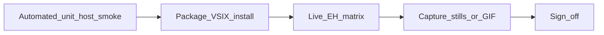

# MCP Watchdog — Testing (pre-ship SoT)

**Last updated:** 2026-11-07  
**Role:** Rigorous automated + live + capture evidence before any tagged cut.  
**Progress / release train:** [STATUS.md](./STATUS.md) · [RELEASE.md](./RELEASE.md).  
**UI scenarios:** [design/SCREEN-SPEC.md](./design/SCREEN-SPEC.md). **Cause fixtures:** [design/CAUSE-CATALOG.md](./design/CAUSE-CATALOG.md).

Historical Gate 1 stills ([VISUAL-QA-IDE.md](./validation/VISUAL-QA-IDE.md), Priya audits) are **archives** — this file is current.



---

## Pyramid

| Layer | What | Network? | Command / how |
|-------|------|----------|----------------|
| Unit | diagnose, derive, verify, Overview/alerts/status, config-core | No | `npm run test:unit` |
| Compile / bundle | types + esbuild | No | `npm run compile` · `npm run build` |
| Host | Extension Host API tests | Local VS Code test electron | `npm run test:host` |
| Smoke | Live npx memory / connect scripts | Yes (controlled) | `npm run smoke` |
| Live EH | Human F5 matrix below | Local MCP only | Manual + evidence folder |
| Capture | Stills / short clip / demo GIF | No secrets in frame | Kap / CleanShot / screencapture |

CI already runs lint/compile/unit (and broader jobs per workflows). **Tagging still requires** the human Live EH + sign-off for user-visible cuts.

---

## Commands (local)

```bash
npm run test:unit
npm run compile
npm run build
npm run smoke          # needs network; optional on docs-only cuts
npm run test:host      # slower; run before user-visible UI/Fix cuts
npx vsce package       # then install the .vsix into a clean profile
```

Full suite when available: `npm test` (see `package.json` — includes compile/build/unit/smoke/integration as wired).

---

## Release matrix (blocking vs advisory)

| Surface | Before tag | Evidence |
|---------|------------|----------|
| Doctor cause / derive / verify | **Blocking** unit | vitest (`diagnose` / `deriveState` / verify) |
| Toast ≤3 (`Fix…` / `Show Log` / `Mute 1h`) | **Blocking** unit + live | `alerts` tests + still of toast |
| Overview cause sentence + first action | **Blocking** unit + live | `overviewHtml` tests + still |
| Status tooltip cause sentence | **Blocking** unit | `statusBarModel` tests |
| Fix Quick Pick full list (not toast-capped) | **Blocking** live for Doctor cuts | still of QP title `Fix {name} ({causeId})` |
| Overview `Verified:` after Fix | **Blocking** for ≥0.5.9 | still after Fix→retry |
| Secrets never on screen / logs | **Blocking** | skim Output + stills; no env/header **values** |
| Dual-truth host Unknown | **Blocking** | still with `Editor session: Unknown` on failed row |
| Packaged VSIX install | **Blocking** user-visible cuts | install `.vsix` in clean profile; G0-style smoke |
| Theme / a11y spot | Advisory | no color-only state; keyboard on primary buttons |
| Full-window pixel-diff CI | Out of scope | — |

---

## Live Extension Host script

Run F5 **Run Extension (mcp-watchdog-test)** or a disposable workspace. Tick pass/fail with date in the cut’s `SIGN-OFF.md`.

Automated stand-in for the same workspace: `npm run test:host` includes `test/host/liveEh.test.ts` (L2–L6/L8; L1 empty-window and L7 verify skipped until available).

| # | Scenario | Expect |
|---|----------|--------|
| L1 | Empty / no folder | Empty CTA; no false “healthy” |
| L2 | Untrusted / need approval | Review & allow; not “Open a folder” when folder open |
| L3 | Healthy echo (or fixture) | Chip `n/n`; Overview Healthy; metric **Reconnecting** label present |
| L4 | Induce failure (kill stdio / missing token HTTP) | Cause **sentence** (not raw log headline); first action link; `Editor session: Unknown` |
| L5 | Failure toast | Exactly ≤3 actions: **Fix…**, **Show Log**, **Mute 1h**; cause in message |
| L6 | Fix Quick Pick | Title includes causeId; list longer than toast when recommend is long |
| L7 | Fix → verify (≥0.5.9) | After remediating step + re-probe: Overview meta `Verified: …` |
| L8 | Accept / Remove (commands or tree) | Accept quietens chip; Remove does not paste secrets |
| L9 | Layout | No horizontal scroll on Overview; primary control reachable |

Aligns with SCREEN-SPEC § Live; expand here when UI changes.

---

## Capture playbook

1. Dark theme. Crop **status bar + Watchdog sidebar + toast** (not full desktop).  
2. Tools: Kap, CleanShot, or macOS Cmd+Shift+5.  
3. **Never** show env/header **values**, API keys, AWS profile secrets, or live OAuth tokens. Names of keys OK.  
4. Store evidence under:

```text
docs/validation/release-evidence/vX.Y.Z/
  SIGN-OFF.md          # required for user-visible tags
  stills/              # png — commit small stills when useful
  clips/               # mp4/mov — gitignored; keep local or attach to GH release
```

5. Demo GIF for store/README: follow [media/GIF-RECORDING.md](./media/GIF-RECORDING.md) (toast ≤3 + optional verify beat).  
6. One Marketplace/Open VSX clip story per announce — do not caption an old Retry/Accept-heavy GIF as current Doctor UI.

---

## Sign-off template

Copy into `docs/validation/release-evidence/vX.Y.Z/SIGN-OFF.md` before tagging a user-visible cut:

```markdown
# Sign-off vX.Y.Z

- Date (UTC):
- Commit SHA:
- Recorder:
- Platforms smoked: Cursor (Open VSX / F5) | VS Code | …
- Automated: test:unit | compile | build | smoke | test:host (tick what ran)
- Live EH L1–L9: pass / fail / skip (list skips)
- Secrets pass: yes / no
- Packaged VSIX installed: yes / no
- GIF updated: yes / no / n/a
- Notes:
- Ship decision: READY | HOLD
```

[RELEASE.md](./RELEASE.md) **refuses** a stable tag for user-visible cuts without this file marked READY.

---

## What this does not replace

- Claim ladder → [STRATEGY-THESIS.md](./STRATEGY-THESIS.md)  
- Marketing checklist → [GTM-PUBLISH.md](./GTM-PUBLISH.md)  
- Bake-off proof → [BAKE-OFF.md](./BAKE-OFF.md)  
