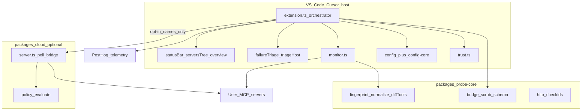

# Architecture note — MCP Watchdog (Scan → Focus)

**Pass:** Focus (promoted from Scan)  
**Date:** 2026-11-07  
**HEAD:** `23f563c` (0.5.6)  
**Skill:** [aetox-skills/senior-architect-agent](https://github.com/aetox-skills/senior-architect-agent) v1.1 discipline  
**Code changes:** none  

**Product context (not decided by this pass):** [STRATEGY-THESIS.md](../STRATEGY-THESIS.md) locks IDE-native **runtime reliability + verified recovery**; compatibility/evidence is a **supporting engine**, not the Marketplace identity. This note judges whether the **built system** can support that thesis — it does not redefine product strategy.

---

## Layer 1 — Synthesis

**High findings**

1. **`src/extension.ts` is a god-orchestrator (~1.2k LOC)** — activation, monitor lifecycle, triage, telemetry, star UX, cloud bridge, trust, and UI wiring share one file. Blast radius of Doctor/incident work is high. Evidence: `src/extension.ts`. Severity: **High**. Confidence: Direct.  
2. **`packages/probe-core` is too thin for a reliability/evidence engine** — exports fingerprint, normalize, diffTools, HTTP check ids, bridge scrub only. Monitor, Doctor (`failureTriage`), auth classify, incidents, and config parsing live in the extension tree (some vscode-free). Evidence: `packages/probe-core/src/index.ts`, `src/monitor.ts`, `src/failureTriage.ts`. Severity: **High**. Confidence: Direct.  
3. **Auth/diagnosis contracts were incomplete for the reliability thesis** — historically `authError` / `failureTriage` mainly matched 401-style and AWS session text; “No token provided” fell to `generic`. **Partial fix (2026-11-07):** agnostic `causeId` + `diagnose` / `RuntimeObservation` types live in `packages/probe-core` (Phase 1); Fix UI emits causeId; durable incidents + host adapters still open. Evidence: `packages/probe-core/src/diagnostics/`, `src/failureTriage.ts`. Severity: **Med** (was High). Confidence: Direct.

**Primary recommendation:** Before feature code, extract vscode-free diagnostics + observation + incident schema into `probe-core` (or sibling packages under the same dependency rule), shrink `extension.ts` to glue, and implement Doctor/verify against that boundary. Do **not** grow Cloud or add runtime deps to chase the thesis.

---

## Pass control

| Item | Value |
|------|-------|
| Started | Scan |
| Promoted to | Focus |
| Trigger | User ask spans 3 packages (extension / probe-core / cloud), reliability-contract blast radius, readiness for evidence/Doctor engine, security/privacy constraints |
| Risk if stayed Scan | Understate coupling and missing abstractions; unsafe handoff into Phase 1 implementation |
| Artifact budget | One note (this file) — no template pack |

---

## Scope & evidence checked

**In scope:** `src/`, `packages/probe-core/`, `packages/cloud/`, `test/unit/`, `scripts/`, `.github/workflows/`, `package.json`, strategy/arch docs.  

**Checked:** entry (`extension.ts`), monitor, config-core/config, trust, failureTriage/triageHost/authError, editorMcp, incidents, cloudBridge/bridge re-exports, probe-core index+schema+bridge, cloud server/policy, CI (`ci.yml` lint/unit/integration/host), unit test inventory (~27 files), sole runtime dep `@modelcontextprotocol/sdk`.  

**Skipped / not deeply verified:** full `monitor.ts` transport branches line-by-line; Cloud Postgres migrations behaviour; Marketplace vs SECURITY telemetry disclosure wording; host test suite contents; Open VSX publish scripts. Marked Unknown where relevant.

---

## Classification

| Area | Status |
|------|--------|
| IDE extension (VS Code/Cursor) | Observed — primary product |
| Shared library (`probe-core`) | Observed — partial extraction |
| Optional Cloud HTTP service | Observed — adjacent OSS preview |
| Persistence | Partial — workspace/globalState + in-memory incidents; Cloud in-memory/Postgres ERD mentioned |
| External services | MCP servers (user); PostHog Capture (telemetry); optional Cloud bridge URL |
| Tests / CI | Observed — vitest unit (no network), smoke/integration scripts, host matrix |
| Frontend web app | Not observed (webview HTML generated in-extension) |
| Microservices mesh | Not observed |

---

## Current architecture overview

**Style [Direct]:** Single VS Code extension host process + thin shared TS package + optional separate Cloud Node server. Not a distributed product core.

**Target R1 topology + thesis goal spine:** [TECHNICAL-ARCHITECTURE.md](../TECHNICAL-ARCHITECTURE.md) §7 / §13 and [STRATEGY-THESIS.md](../STRATEGY-THESIS.md) (pivot → bake-off → metrics → earned moat). This diagram is Architecture 0 as-built only.

---

## Critical module & dependency map

| Module | Responsibility | Depends on | Consumers |
|--------|----------------|------------|-----------|
| `extension.ts` | Activate, wire everything | almost all `src/*`, vscode | host |
| `monitor.ts` | Probe lifecycle, states, drift hooks | MCP SDK, probe-core schema/fingerprint, authError, options | extension |
| `config-core.ts` | Parse/merge mcp.json **without vscode** | node/fs patterns | config.ts, tests |
| `config.ts` | VS Code workspace paths, watchers | vscode, config-core | extension |
| `failureTriage.ts` | Classify + Fix steps | config-core types, monitor status | extension, triageHost |
| `triageHost.ts` | Execute Fix/Remove | vscode, recipes, secrets | extension |
| `incidents.ts` | In-memory transition ring | monitor states | extension |
| `editorMcp.ts` | Best-effort workbench.mcp.* | injectable host | extension, alerts |
| `probe-core` | Fingerprint/diff/scrub/check ids | none of vscode | monitor, bridge, cloudBridge |
| `cloud` | Registry poll, bridge ingest, policy | node:http, own store | optional deploy; extension posts bridge |

**Dependency rule [Direct]:** Workspace rule + practice: `monitor`, `config-core`, `failureTriage`, `incidents`, `editorMcp` (planning) avoid `vscode` imports. UI/logger/extension import vscode. **Violation risk:** logic that should be shared with CLI still sits under `src/` next to vscode modules — packaging boundary is convention, not enforced package exports beyond probe-core.

**Runtime deps [Direct]:** only `@modelcontextprotocol/sdk` (`package.json`).

---

## Confirmed facts

- Five UI states only: `connecting|healthy|degraded|failed|disconnected` (`monitor.ts`).  
- Dual-truth documented: Watchdog probe ≠ editor client; `editorMcp` often unavailable.  
- Trust gate before spawn (`trust.ts`); untrusted workspaces unsupported (`package.json` capabilities).  
- Secret redaction path exists (`secretRedact`, bridge scrub REJECTED keys).  
- Schema drift detection uses probe-core `diffTools` / fingerprints from monitor after successful listTools.  
- CI: lint + compile, unit on 3 OS, smoke/integration, host tests vs VS Code 1.105 + stable.  
- Cloud hard-codes protocolVersion `2025-11-25` in initialize (`packages/cloud/src/server.ts`) — era matrix not generalized.  

---

## Inferences / assumptions

- **Inferred:** Extracting Doctor into probe-core is the lowest-risk path to CLI reuse later (matches TECHNICAL-ARCHITECTURE intent). Verify first: Yes.  
- **Inferred:** `extension.ts` size will continue to grow with Doctor/verify/KB unless split.  
- **Assumed for readiness scoring:** STRATEGY-THESIS Phases 1–3 remain the near-term engineering target (not Cloud-first PRODUCT-DECISION narrative).  

---

## Architecture debt register (ranked)

| Sev | Finding | Impact | Evidence | Smallest safe correction (proposed) |
|-----|---------|--------|----------|-------------------------------------|
| High | God orchestrator `extension.ts` | Every reliability feature touches one blast radius | LOC ~1216; imports monitor/triage/telemetry/star/cloud/trust | Split activation modules: `activateMonitor`, `activateTriage`, `activateTelemetry` — no behaviour change |
| High | Evidence/Doctor not in probe-core | Cannot share Doctor with CLI/CI without vscode tree; tests tied to extension layout | probe-core index exports; failureTriage in src | Move pure classify + observation types into probe-core; keep triageHost in extension |
| High | Weak auth taxonomy vs real HTTP MCP failures | Wrong Fix path; trust loss | authError/failureTriage regexes | Widen classifier + fixtures; no new UI state |
| Med | Incidents ephemeral | No verified-recovery or recurrence learning | incidents.ts capacity 200 RAM | Persist scrubbed IncidentRecord locally (Phase 3) |
| Med | Dual docs / strategy drift | Agents may follow Cloud-raise narrative over runtime thesis | PRODUCT-DECISION vs STRATEGY-THESIS | Prefer STRATEGY-THESIS (already pointer-updated) |
| Med | Cloud protocol era pinned | Wrong initialize against modern servers | cloud server.ts `2025-11-25` | Protocol matrix / negotiation when Cloud is in scope |
| Low | Bridge re-export shim | Mild indirection | src/bridge/* re-exports probe-core | Keep; fine |
| Low | No npm workspaces field | probe-core linked via esbuild alias | package.json build script | Optional workspaces later — not blocking |

---

## Compatibility / evidence-engine readiness

| Capability needed | Built today? | Gap |
|-------------------|--------------|-----|
| Protocol version / era awareness | Partial (SDK client; Cloud pinned) | No shared support matrix module |
| Capability negotiation model | Not observed as first-class | Missing abstraction |
| Multi-fingerprint contracts | Partial (tool fingerprint + schema diff) | No versioned Contract entity / soft-stop |
| Test fixtures / ExecutionPolicy | HTTP check ids + unit fixtures; no ExecutionPolicy | Missing |
| EvidenceRecord | Not observed | Missing |
| RuntimeObservation multi-dimension | Collapsed into ServerState + ad-hoc fields | Missing |
| Persistence for incidents/evidence | Ring buffer only | Missing |
| Security/redaction for evidence | Scrub patterns exist | Must apply before any new persist |
| Host adapter interface | editorMcp best-effort only | No HostCapabilities |
| Doctor + verified recovery | Classify + Fix steps; no verify loop | Partial |

**Verdict [Inferred]:** Design **can** support a protocol-aware evidence engine **if** vscode-free core grows deliberately. It **cannot** do so by bolting features only into `extension.ts`. Cloud is optional and should not become the evidence SoT.

---

## Top five architectural risks

1. **Implementing Doctor only in the extension** → permanent vscode coupling; CLI/CI and compounding KB blocked.  
2. **False-certainty UI** (collapsing probe+host into one green) → contradicts dual-truth; destroys moat thesis.  
3. **Persisting incidents without redaction discipline** → secret leakage / Marketplace trust failure.  
4. **Adding runtime deps or required proxy early** → friction; competes with Bastion/Pacemaker wiring trade-off before non-invasive path is proven.  
5. **Cloud/protocol drift** while IDE Doctor unfinished → split focus; era bugs in author-monitor path.

---

## Open questions

1. Will Cursor expose a reliable MCP connection-status API in the next 6–12 months? (drives HostCapabilities richness) — **defer**; default `hostConnection: unknown`.  
2. Incident store path — **resolved in ARCH §6:** workspace `.mcp-watchdog/incidents.jsonl` (+ memory fallback).  
3. `monitor.ts` in Phase 1? — **resolved in ARCH §5b:** diagnostics/types only into probe-core; monitor stays in `src/` for Phase 1.  
4. Bake-off vs Bastion/Pacemaker — **method locked** in [BAKE-OFF.md](../BAKE-OFF.md); outcome still pending a dated run.

---

## Safe next actions (proposed — require approval)

1. **Keep product strategy outside this skill** — STRATEGY-THESIS remains authority.  
2. **Phase 1 extraction (smallest):** add `packages/probe-core` modules for `RuntimeObservation`, agnostic failure taxonomy, redaction helpers; leave vscode in `triageHost`/`extension`.  
3. **Split `extension.ts` wiring** without behaviour change (test: unit + host still green).  
4. **Auth classifier fixtures** (missing token / 401 / max-retries peel) before UI polish.  
5. **Defer Cloud protocol generalization** until IDE Doctor verify loop exists.  
6. **Run competitor bake-off** (product validation) in parallel — architecture does not replace it.

---

## Validation

1. **Claim traceability:** Findings cite paths; skipped areas named.  
2. **Scope alignment:** Focus on reliability core + readiness; did not invent microservices or full redesign.  
3. **Handoff:** Unknowns + safe next actions present; no source edits performed.

**Verify first:** Promotion trigger justified by user ask + three-package evidence — Yes.
