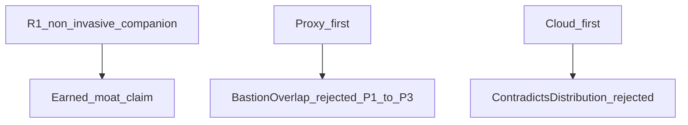

# Design resume — mcp-watchdog reliability architecture

**Slug:** `mcp-watchdog`  
**Mode:** repository (evolution of Architecture 0)  
**Status:** recommendation accepted for Phases 1–3 (2026-11-07) — decisions locked in TECHNICAL-ARCHITECTURE §5–5b / §6 / §12  
**Human SoT:** [../TECHNICAL-ARCHITECTURE.md](../TECHNICAL-ARCHITECTURE.md)  
**Product thesis:** [../STRATEGY-THESIS.md](../STRATEGY-THESIS.md)  
**Bake-off:** [../BAKE-OFF.md](../BAKE-OFF.md)

## Recommendation

**R1 — Non-invasive IDE reliability companion:** evolve existing extension + `probe-core` with Doctor, RuntimeObservation, swappable host adapters, verified recovery, and local incident KB. Do not require a proxy. Do not rewrite as cloud-first.

## Closed alternatives (one-liners)

- Required proxy-first → friction / Bastion overlap; Phase 6 optional only  
- Cloud-first rewrite → contradicts distribution wedge and single-user envelope  
- Compatibility-platform-primary → contested market; keep as supporting engine  

## Envelope

Single-developer IDE extension; ~1–20 MCP servers; local persistence; probe interval seconds–minutes. Distributed topology not earned.

## Protected invariants

Dual-truth + Unknown · vscode-free probe-core · five UI states derived · secrets never in evidence · verify before claiming recovery · retry ≠ root cause  

## Next measurements that could overturn R1

- Bake-off loses to Bastion/Pacemaker on verified recovery for common failures **and** users accept proxy/bridge wiring  
- Host APIs remain permanently unavailable **and** users do not value Unknown honesty  
- Diagnose%/resolve% flat after Phase 3  

## Debt carried into Phase 1

Auth classifier too narrow · ephemeral incidents · host often Unknown · observation collapsed into ServerState  

## Investigation notes

Architecture 0 reconstructed from `src/monitor.ts`, `failureTriage.ts`, `editorMcp.ts`, `incidents.ts`, `packages/probe-core`, `trust.ts`, `authError.ts` (2026-11-07). Skills used: proyecto26 system-design loop + resilience/requirements blocks; pinchen repository-evolution method (install YAML blocked; process followed from cloned SKILL).
