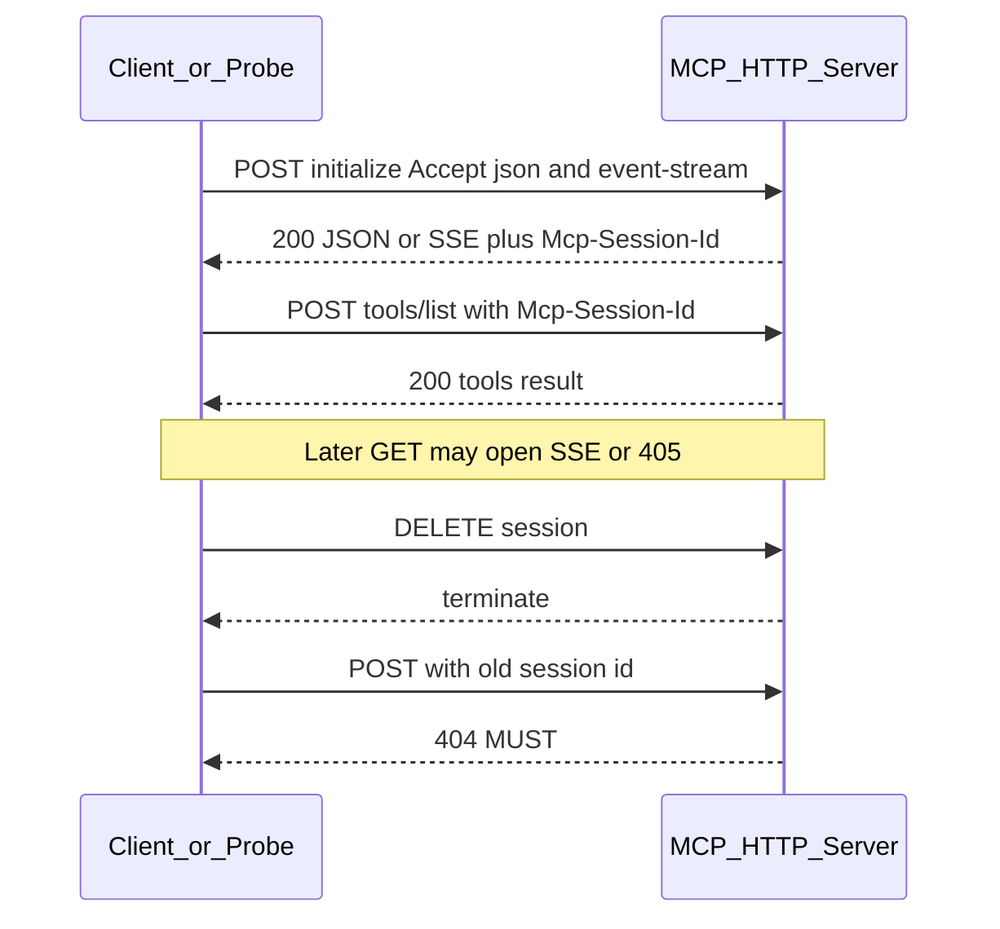

# Spike R1 — Streamable HTTP / session

**Status:** researched (2026-10-30)  
**Primary teacher:** [Chinmay-92/mcp-http-probe](https://github.com/Chinmay-92/mcp-http-probe) (MIT, spec **2025-11-25**)  
**Also:** [Openstatus MCP health](https://www.openstatus.dev/play/mcp-health), MCP TS/Python SDK streamable HTTP tests, [mcp-healthcheck](https://github.com/silupanda/mcp-healthcheck), [sednalabs/mcp-probe](https://github.com/sednalabs/mcp-probe)

## Why this spike

SDK unit tests prove the SDK. Real breakage is express glue, session maps, auth middleware, and reverse proxies. Watchdog today is an **SDK client** (`StreamableHTTPClientTransport` + `ping` + optional `listTools`) — it does **not** assert server MUST/SHOULD status codes.

## State machine (client view)

## MUST / SHOULD check table (steal from mcp-http-probe)

| id | Level | Rule | Expected |
|---|---|---|---|
| `accept-header` | SHOULD | POST Accept omits `text/event-stream` | 406/400 |
| `origin-validation` | MUST | foreign `Origin` | **403** (DNS rebinding) |
| `initialize` | MUST | POST initialize | success |
| `content-type` | MUST | response | `application/json` or `text/event-stream` |
| `protocol-version` | SHOULD | negotiate | `2025-11-25` |
| `server-info`, `capabilities` | MUST | initialize result shape | present |
| `session-id-charset` | MUST | `Mcp-Session-Id` | visible ASCII `0x21–0x7E` |
| `notification-202` | MUST | accepted notification | **202**, empty body |
| `ping` | MUST | ping | empty result |
| `method-not-found` | SHOULD | unknown method | `-32601` |
| `protocol-version-header` | MUST | unsupported `MCP-Protocol-Version` | **400** |
| `session-required` | SHOULD | missing session | **400** |
| `session-unknown` | MUST | unknown session | **404** (not 400/500) |
| `tools-list` / `tool-input-schema` / `tool-unique` | MUST | tools/list | object `inputSchema`, unique names |
| `tool-names` / `tool-descriptions` | SHOULD | naming + descriptions | 2025-11-25 rules |
| `get-stream` | MUST | GET | SSE **or** 405 |
| `session-delete` / `session-terminated` | SHOULD/MUST | DELETE then reuse | later → **404** |

CI exit: **1** if any MUST fails (or SHOULD with `--strict`).

## Failure modes that matter for reliability product

1. **False green:** HTML 200 / wrong Accept / no session — Openstatus taxonomy (GOOD/WARN/AUTH/DOWN).
2. **Wrong session errors:** 400/500 instead of **404** → clients cannot start a new session cleanly.
3. **Origin off by default:** TS SDK transport leaves Origin validation off; README servers fail `origin-validation`.
4. **Notification 200 `{}`:** confuses strict clients; MUST be 202.
5. **tools/list ≠ callable:** list-only health is incomplete ([k08200/mcp-probe](https://github.com/k08200/mcp-probe) dry-run later).

## Gap vs Watchdog today

| Capability | mcp-http-probe | Watchdog `src/monitor.ts` |
|---|---|---|
| Transport | Black-box HTTP status matrix | SDK connect + ping |
| Origin / Accept / version header | Explicit checks | Not asserted |
| Unknown/terminated session → 404 | Explicit | Not asserted |
| tools/list | Schema MUST checks | Name-only fingerprint (`computeToolsFingerprint`) |
| Notification 202 | Explicit | N/A (client) |
| Passive rebinding | Covered | N/A |

**Implication for probe-core / cloud author monitor:** reuse mcp-http-probe’s **check IDs + expected codes** as the fixture corpus for T0; do not invent a parallel matrix. Watchdog IDE can stay SDK-based for latency/health UX; **author cloud** and **probe-core CLI** should expose a subset of MUST checks (at minimum: initialize, session-unknown→404, tools/list shape).

## Fixture corpus (minimum to implement)

Store request/response pairs (no secrets) keyed by check id:

1. `initialize` happy path + session header present  
2. `session-unknown` → 404  
3. `session-terminated` after DELETE → 404  
4. `protocol-version-header` unsupported → 400  
5. `origin-validation` foreign Origin → 403  
6. `notification-202` → 202 empty  
7. `accept-header` missing event-stream → 406/400  
8. `tools-list` with non-object `inputSchema` → fail  
9. `get-stream` → SSE or 405  

## Decisions locked (logic audit 2026-10-30)

- Spec revision target: **2025-11-25**.
- **Three probe packs** (do not flatten into one uptime signal):

| Pack | Checks | Default alert? |
|---|---|---|
| **Liveness** | initialize; content-type; tools/list shape; latency | Yes |
| **Session hygiene** | unknown session → **404**; after DELETE → **404** (when sessionful) | Yes |
| **Conformance** | Origin → 403; Accept; notif 202; protocol 400; GET SSE\|405 | Opt-in / self-host only |

- Origin MUST for servers (spec) but **must not** page third-party author-monitor uptime (false-red).
- Author default = liveness + session hygiene when `Mcp-Session-Id` present — not initialize-only.

## Next code action

Fixtures under `packages/probe-core/fixtures/http/` tagged by pack; T0 runs liveness+session on fixture; Origin non-fatal for public URLs.

## REA evidence (repo, not README)

- Clone: `docs/spikes/repos/mcp-http-probe`
- `rea analyze-javascript-application` → evidence `ev_6ec08e83435bde5ae7cecb8017f3f9abc923cec54e0cd54a996f7238c46194d8` (53 nodes / 65 edges; parsed `src/index.ts`, `src/cli.ts`, tests, reference server)
- Logic confirmed in **`src/index.ts`**: `origin-validation` MUST 403; `session-unknown` MUST 404; session delete / 405; tool listing INFOs
- Full write-up: [REA-EVIDENCE.md](./REA-EVIDENCE.md)
